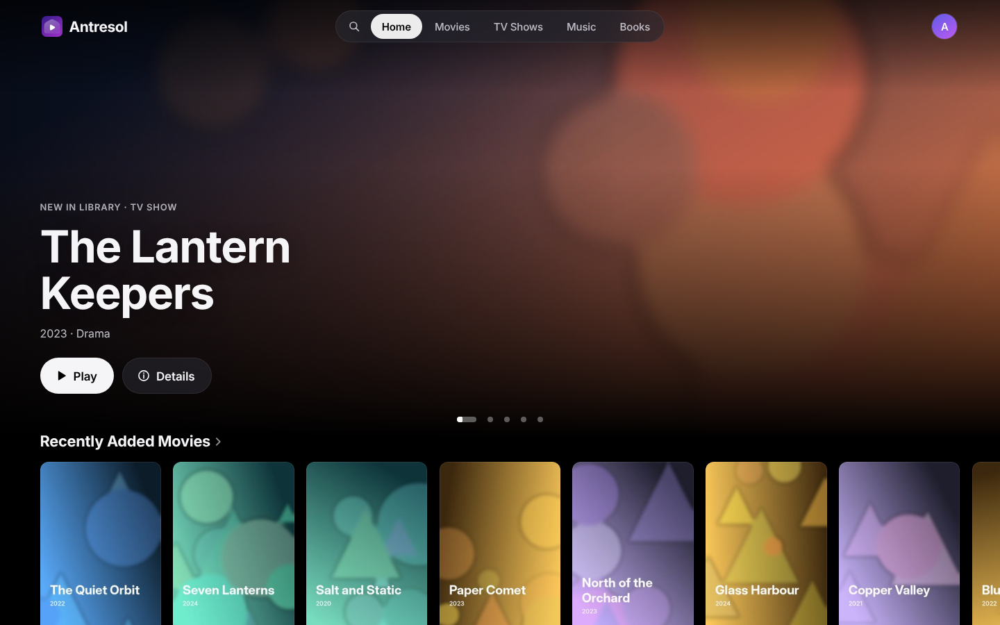
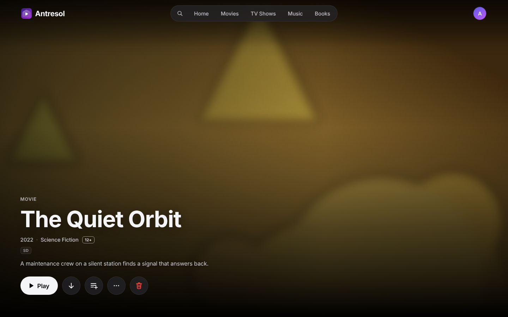
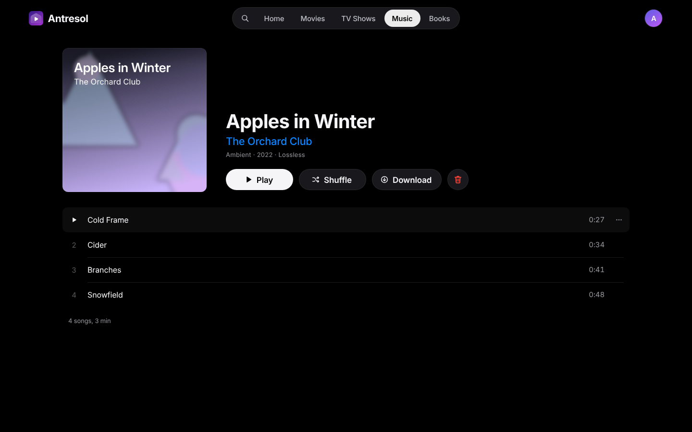
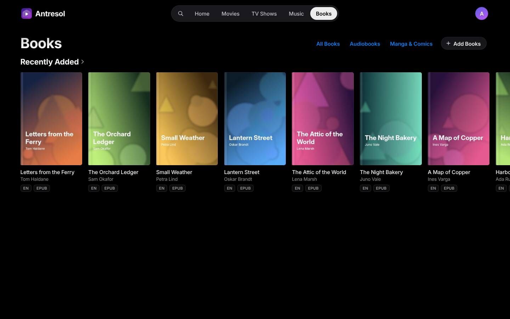
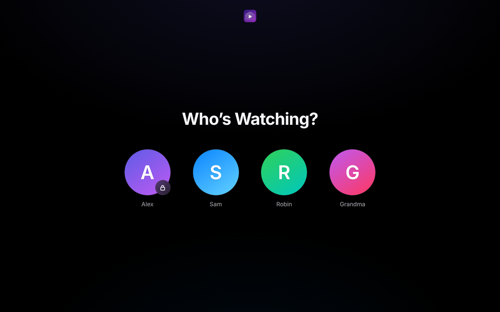
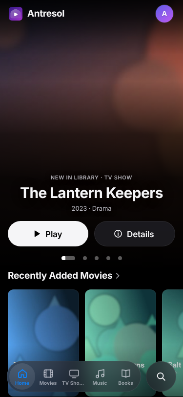

# Antresol

**A home media server for the films, series, music, audiobooks, books and
comics you already have.** Point it at your folders, open it in a browser,
and the whole family gets one library with profiles, progress that follows
you between devices, and a player that works at home and away.

[Русский](README.ru.md)



> **Honest statement.** Antresol is maintained by one person, with AI
> assistance. No content is provided: Antresol plays only the files you put
> in your own folders and fetches descriptions and artwork for them. Only add
> media you have the rights to. The iPhone, iPad and Mac app is closed source
> and talks to the server through the same public API as the web interface;
> the server and the web interface in this repository are open source (see
> [Licence](#licence)).

## What it does

- **Films and series** with posters, descriptions, cast and seasons. Plays
  in the browser: the original file when the browser can, otherwise a
  remux or a transcode, with hardware decoding where the host's ffmpeg has
  it (Intel Quick Sync, VideoToolbox). Audio tracks, subtitles, skip intro
  and credits, a quality limit for viewers away from home.
- **Music**: albums, artists, playlists, CUE images, synced lyrics,
  near-gapless playback, loudness levelling. Subsonic API for music apps.
- **Books, audiobooks, manga and comics**: an EPUB, FB2 and PDF reader with
  highlights and notes, an audiobook player with chapters and a sleep timer,
  a comic reader with right-to-left reading. OPDS catalogue for e-reader
  apps.
- **Profiles** for the household, with passwords, kid profiles that see only
  what is allowed for them, and screen time.
- **Offline**: save an album, a book or a volume to the device from the web
  app and use it without a connection; positions sync when you are back.
- **Metadata** from TMDB, MusicBrainz, the Cover Art Archive and Open Library.
  Each can be switched off.
- Interface in Russian and English.
- One self-contained Go binary with the web interface built in; a SQLite
  database; no other services needed.

<p>
  
  
</p>
<p>
  
  
</p>
<p></p>

## Install with Docker

You need a Linux host with Docker and Compose, and your media in one folder:

```
/srv/media/
  movies/      Film Title (2019)/Film Title (2019).mkv
  series/      Series Title/Season 01/Series Title S01E01.mkv
  music/       Artist/2019 - Album/01 - Track.flac
  books/
    ebooks/      Author - Title.epub
    audiobooks/  Author - Title/*.mp3  (or one .m4b)
    manga/       Series/Volume 01.cbz
```

Then, next to [`compose.yml`](compose.yml):

```sh
cp .env.example .env          # optional: a TMDB key, your time zone, your proxy
MEDIA_DIR=/srv/media docker compose up -d
```

Open `http://<host>:8420` from your home network and create the first
administrator. The server scans the folders at start and every 15 minutes
(or at once from Manage → Settings in the web interface).

- The container runs as uid/gid 1000 and needs to write to the media folder
  (subtitles it fetches, temporary transcode files). Settings and the
  database live in the `antresol-config` volume.
- The image has no GPU video driver yet, so it transcodes on the CPU. For
  hardware decoding run the binary on the host (see below), where ffmpeg
  uses the host's drivers (`VAULT_HWACCEL`).
- Outside your home network, put Antresol behind a reverse proxy with HTTPS
  and set `VAULT_TRUSTED_PROXIES` to the proxy's address. A profile without
  a password can sign in only from the home network.
- Every setting is an environment variable; `.env.example` lists the common
  ones and [docs/build-tags.md](docs/build-tags.md) explains the build.

**Upgrading from 0.3.0.** The old image gets no new releases: in your old
compose file or `docker run` command, change the image to the one in
`compose.yml`. Keep the same `/config` and the media at the same path inside the
container: the database stores full file paths, so settings, profiles and
progress then stay as they were. With the published image nothing else changes.
An image you built yourself from the old Dockerfile set `VAULT_MEDIA_ROOT` to
another path on its own, and with it unset the server now uses `/media`: set it
to the path you mount the media at. Until you do, the server finds no new files,
and the items it already knows stay. Mounting the media at a new path instead
changes the paths: the library is indexed anew, each item appears a second time
without its progress, and the old entries stay and no longer play.

This `compose.yml` as it stands makes a fresh install: its
`antresol-config` volume is new and empty, so there are no profiles and no
progress. Point its `/config` at your old folder to keep them; then the paths
change as above, because it looks in `movies/`, not `media/movies/`.

## Build from source

Requirements: Go 1.27, Node 22 (see `.nvmrc`), and `ffmpeg` and `ffprobe`
6.1 or newer on the `PATH`. ffmpeg 6.0 and older do not know
`-readrate_initial_burst`, which every remux and transcode passes, so on them
only direct play works. The Docker image already carries a newer ffmpeg.

```sh
make build                      # web bundle, then bin/vault with it embedded
VAULT_DATA_DIR=./data VAULT_MEDIA_ROOT=/srv/media bin/vault
```

`make test` runs the Go tests, `make test-web` the web unit tests and
`make e2e` the browser tests (Playwright). `docker build .` builds the
server image. `vault` is the code name: you will see it in
the binary, the `VAULT_*` variables and the database file.

## Apps

- **iPhone, iPad and Mac**: the Antresol app on the App Store. It is closed
  source for now and uses the server's public API. (Its book reader is built
  from the MPL-2.0 files of this repository; see [LICENSING.md](LICENSING.md).)
- **Music**: any Subsonic client. Create an app password in the profile
  menu, then use the server address, your profile name and that password.
- **E-readers**: any OPDS reader, at `<server>/opds`, with the same app
  password.

## Contributing

Contributions are welcome, in English or Russian. Read
[CONTRIBUTING.md](CONTRIBUTING.md) first: sign-off (DCO), what is in scope,
the UI rules, and how AI-assisted work is handled. Please open an issue
before large or visual changes. Security problems: [SECURITY.md](SECURITY.md).
Everyone taking part follows the [Code of Conduct](CODE_OF_CONDUCT.md).
How decisions are made: [GOVERNANCE.md](GOVERNANCE.md).

## Licence

Antresol Server is free software under the
[GNU Affero General Public License v3.0 or later](LICENSE)
(`AGPL-3.0-or-later`). The native reader and the translations
(`web/reader-native.html`, nine files in `web/src/reader`, and
`web/src/i18n`) are under the [Mozilla Public License 2.0](web/src/reader/LICENSE)
(`MPL-2.0`). [LICENSING.md](LICENSING.md) lists the zones exactly,
[NOTICE](NOTICE) and [THIRD_PARTY_LICENSES.md](THIRD_PARTY_LICENSES.md) cover
third-party code.

Every server offers its source: the sign-in screens and the profile menu
(About this server) show a "Source code · AGPL" link, and `GET /api/about`
answers with the version, the commit, the licence and the link. Release builds
link to their tag; a build from source shows no link until you give it one.
If you let others use a modified server, the AGPL asks you to offer them your
source: set `VAULT_SOURCE_URL` to where it is (or build with
`make SOURCE_URL=<url>`).

The name "Antresol" and the logo are not covered by these licences; see
[TRADEMARKS.md](TRADEMARKS.md).

This product uses the TMDB API but is not endorsed or certified by TMDB.
