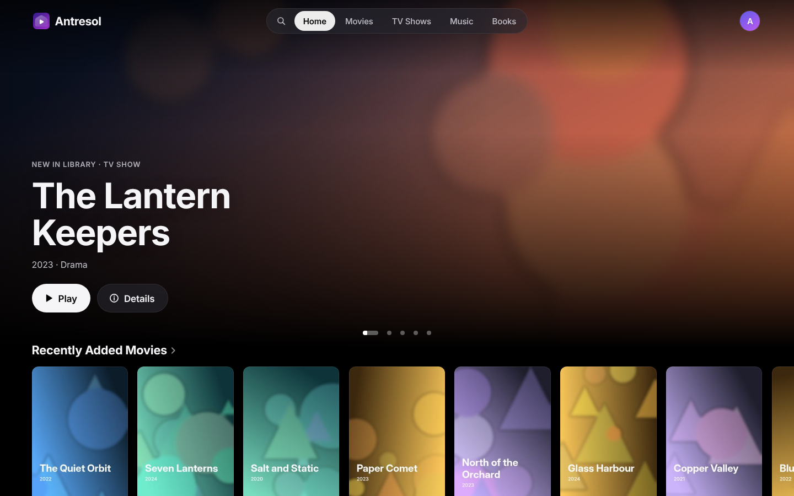
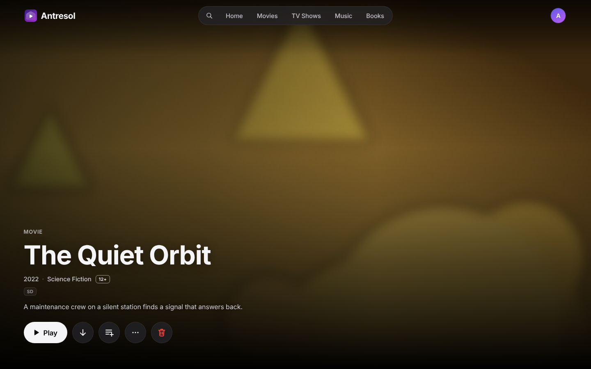
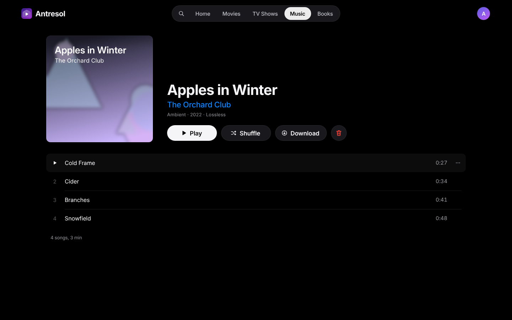
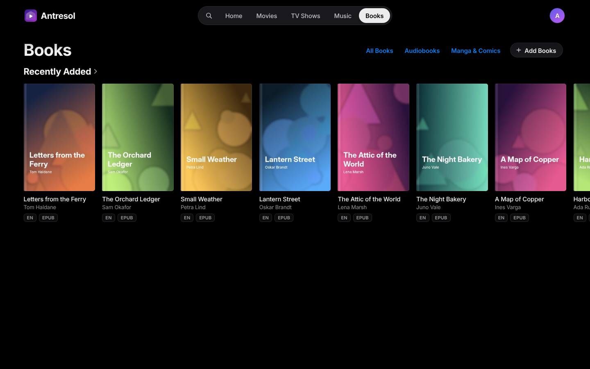
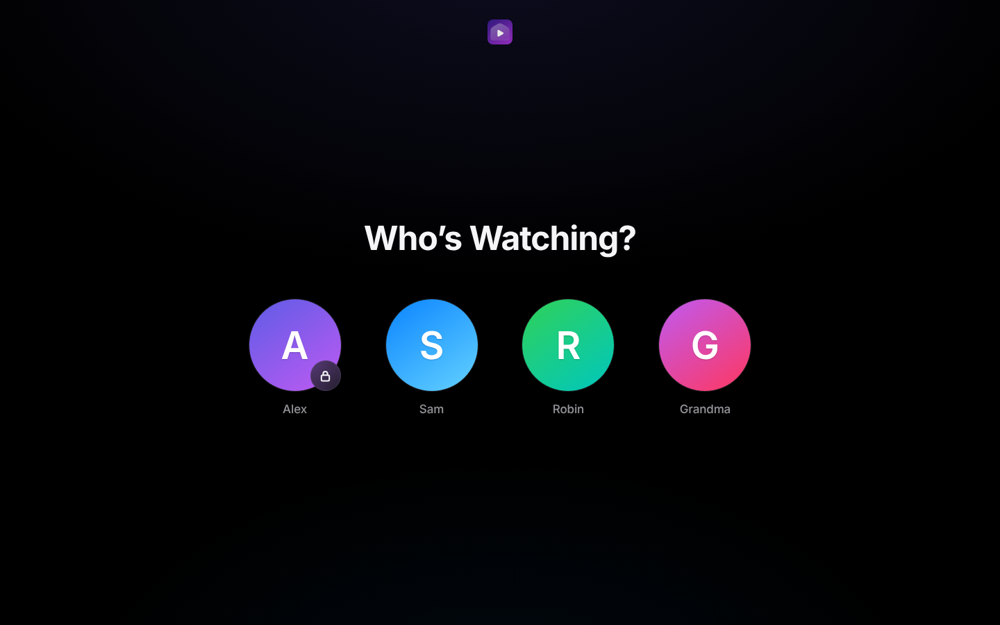
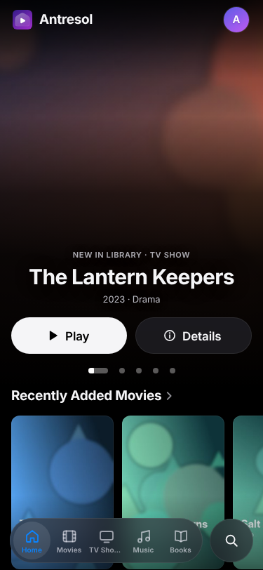

# Antresol

**Домашний медиасервер для фильмов, сериалов, музыки, аудиокниг, книг и
комиксов, которые у вас уже есть.** Укажите ему свои папки, откройте его в
браузере, и у всей семьи будет одна медиатека с профилями, прогрессом,
который переходит с устройства на устройство, и плеером, который работает и
дома, и вне дома.

[English](README.md)



> **Честно о проекте.** Antresol поддерживает один человек с помощью ИИ.
> Никакого контента проект не предоставляет: Antresol играет только файлы из
> ваших собственных папок и подбирает к ним описания и обложки. Добавляйте
> только то, на что у вас есть права. Приложение для iPhone, iPad и Mac
> закрытое и работает с сервером через тот же публичный API, что и
> веб-интерфейс; сервер и веб-интерфейс в этом репозитории открыты (см.
> [Лицензия](#лицензия)).

## Что он умеет

- **Фильмы и сериалы** с постерами, описаниями, актёрами и сезонами. Играет
  в браузере: исходный файл, если браузер его понимает, иначе ремукс или
  перекодирование, с аппаратным декодированием, где его умеет ffmpeg хоста
  (Intel Quick Sync, VideoToolbox). Звуковые дорожки, субтитры, пропуск
  заставки и титров, ограничение качества для зрителей вне дома.
- **Музыка**: альбомы, исполнители, плейлисты, CUE-образы, синхронный текст,
  почти бесшовное воспроизведение, выравнивание громкости. Subsonic API для
  музыкальных приложений.
- **Книги, аудиокниги, манга и комиксы**: читалка EPUB, FB2 и PDF с
  выделениями и заметками, плеер аудиокниг с главами и таймером сна,
  читалка комиксов с чтением справа налево. OPDS-каталог для приложений-читалок.
- **Профили** для всей семьи: пароли, детские профили, которые видят только
  разрешённое, экранное время.
- **Офлайн**: альбом, книгу или том можно сохранить на устройство из
  веб-приложения и открыть без связи; позиции дойдут до сервера, когда связь
  вернётся.
- **Метаданные** из TMDB, MusicBrainz, Cover Art Archive и Open Library.
  Каждый источник можно выключить.
- Интерфейс на русском и английском.
- Один самодостаточный бинарь на Go со встроенным веб-интерфейсом, база
  SQLite, других сервисов не нужно.

<p>
  
  
</p>
<p>
  
  
</p>
<p></p>

## Установка через Docker

Нужен Linux-хост с Docker и Compose и медиатека в одной папке:

```
/srv/media/
  movies/      Название фильма (2019)/Название фильма (2019).mkv
  series/      Сериал/Season 01/Сериал S01E01.mkv
  music/       Исполнитель/2019 - Альбом/01 - Трек.flac
  books/
    ebooks/      Автор - Название.epub
    audiobooks/  Автор - Название/*.mp3  (или один .m4b)
    manga/       Серия/Том 01.cbz
```

Затем рядом с [`compose.yml`](compose.yml):

```sh
cp .env.example .env          # по желанию: ключ TMDB, часовой пояс, адрес прокси
MEDIA_DIR=/srv/media docker compose up -d
```

Откройте `http://<хост>:8420` из домашней сети и создайте первого
администратора. Сервер просматривает папки при старте и каждые 15 минут
(или сразу: Управление → Настройки в веб-интерфейсе).

- Контейнер работает от uid/gid 1000, ему нужна запись в папку медиатеки
  (скачанные субтитры, временные файлы перекодирования). Настройки и база
  лежат в томе `antresol-config`.
- В образе пока нет драйвера видеокарты, поэтому он перекодирует на
  процессоре. Для аппаратного декодирования запускайте бинарь прямо на хосте
  (см. ниже): ffmpeg возьмёт драйверы хоста (`VAULT_HWACCEL`).
- Для доступа не из дома поставьте Antresol за обратный прокси с HTTPS и
  укажите адрес прокси в `VAULT_TRUSTED_PROXIES`. Профиль без пароля входит
  только из домашней сети.
- Все настройки задаются переменными окружения; основные перечислены в
  `.env.example`, сборка описана в [docs/build-tags.md](docs/build-tags.md).

**Обновление с версии 0.3.0.** На старый образ новые версии больше не выходят:
в прежнем compose-файле или команде `docker run` замените образ на тот, что в
`compose.yml`. Оставьте тот же `/config` и медиатеку по тому же пути в
контейнере: в базе записаны полные пути к файлам, и тогда настройки, профили и
прогресс остаются как были. С опубликованным образом больше ничего менять не
надо. Образ, собранный вами из старого Dockerfile, сам задавал
`VAULT_MEDIA_ROOT` с другим путём, а без него сервер теперь берёт `/media`:
задайте его равным пути, куда подключена медиатека. Пока он не задан, новые файлы
не находятся, а уже известные сервер не теряет. Если вместо этого подключить
медиатеку по новому пути, пути изменятся: медиатека проиндексируется заново,
каждая позиция появится второй раз без прогресса, а старые записи останутся и
перестанут воспроизводиться.

Запуск с этим `compose.yml` как есть — это новая установка: его том
`antresol-config` новый и пустой, поэтому профилей и прогресса в нём нет. Чтобы
сохранить их, укажите в нём `/config` на прежнюю папку; тогда пути изменятся, как
описано выше, потому что он ищет в `movies/`, а не в `media/movies/`.

## Сборка из исходников

Нужны Go 1.27, Node 22 (см. `.nvmrc`), а также `ffmpeg` и `ffprobe` версии
6.1 или новее в `PATH`. ffmpeg 6.0 и старше не знает
`-readrate_initial_burst`, а его передаёт каждый ремукс и каждое
перекодирование, так что с ним работает только прямое воспроизведение. В
Docker-образе ffmpeg уже новее.

```sh
make build                      # веб-бандл, затем bin/vault со встроенным бандлом
VAULT_DATA_DIR=./data VAULT_MEDIA_ROOT=/srv/media bin/vault
```

`make test` запускает тесты Go, `make test-web` — юнит-тесты веба,
`make e2e` — браузерные тесты (Playwright). `docker build .` собирает образ
сервера. `vault` — кодовое имя проекта: оно осталось в бинаре, переменных
`VAULT_*` и файле базы.

## Приложения

- **iPhone, iPad и Mac**: приложение Antresol в App Store. Пока оно закрытое
  и работает через публичный API сервера. (Его читалка книг собрана из
  файлов этого репозитория под MPL-2.0; см. [LICENSING.md](LICENSING.md).)
- **Музыка**: любой Subsonic-клиент. Создайте пароль для приложений в меню
  профиля и укажите адрес сервера, имя профиля и этот пароль.
- **Читалки**: любое OPDS-приложение, адрес `<сервер>/opds`, тот же пароль
  для приложений.

## Участие

Мы рады правкам на английском и на русском. Сначала прочтите
[CONTRIBUTING.md](CONTRIBUTING.md): подпись (DCO), что входит в проект,
правила интерфейса и как мы относимся к работе с помощью ИИ. Перед большими
или визуальными изменениями откройте issue. Уязвимости — по
[SECURITY.md](SECURITY.md). Все участники соблюдают
[Кодекс поведения](CODE_OF_CONDUCT.md). Как принимаются решения —
[GOVERNANCE.md](GOVERNANCE.md).

## Лицензия

Antresol Server — свободная программа под лицензией
[GNU Affero General Public License v3.0 или новее](LICENSE)
(`AGPL-3.0-or-later`). Читалка для приложения и переводы
(`web/reader-native.html`, девять файлов в `web/src/reader` и `web/src/i18n`)
распространяются под [Mozilla Public License 2.0](web/src/reader/LICENSE)
(`MPL-2.0`). Точный список — в [LICENSING.md](LICENSING.md), сторонний код —
в [NOTICE](NOTICE) и [THIRD_PARTY_LICENSES.md](THIRD_PARTY_LICENSES.md).

Каждый сервер предлагает свой исходный код: на экранах входа и в меню
профиля («О сервере») есть ссылка «Исходный код · AGPL», а `GET /api/about`
отвечает версией, коммитом, лицензией и ссылкой. Сборки релизов ссылаются на
свой тег; сборка из исходников ссылки не показывает, пока вы её не зададите.
Если вашим изменённым сервером пользуются другие, AGPL просит предложить им
ваш исходный код: укажите, где он, в `VAULT_SOURCE_URL` (или соберите с
`make SOURCE_URL=<адрес>`).

Название «Antresol» и логотип этими лицензиями не охватываются; см.
[TRADEMARKS.md](TRADEMARKS.md).

Этот продукт использует TMDB API, но не одобрен и не сертифицирован TMDB.
