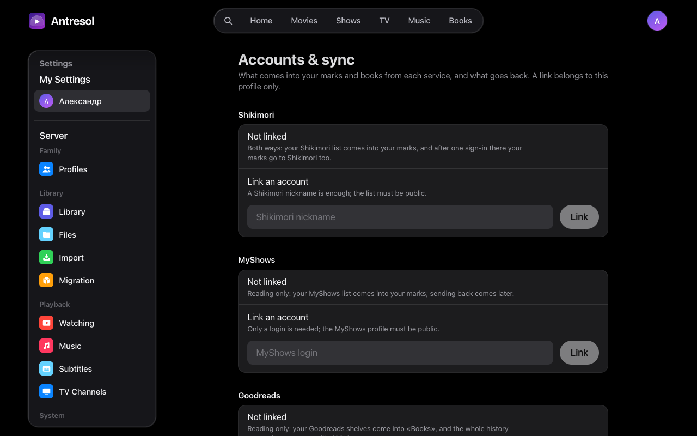
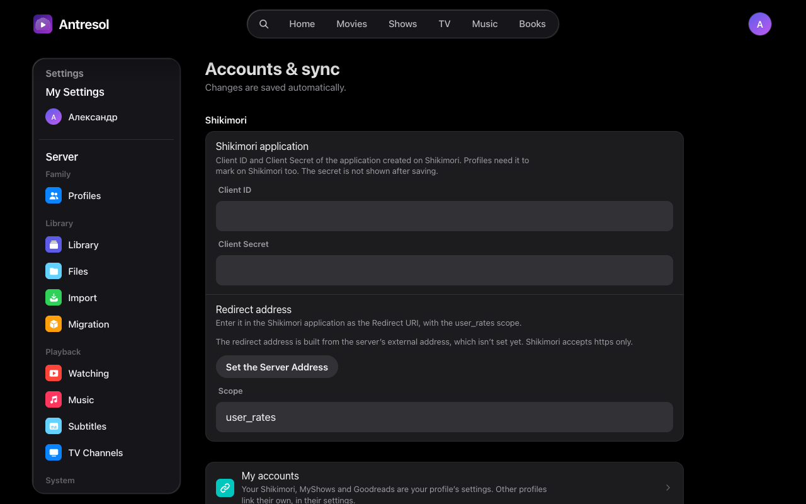

# Shikimori, MyShows and Goodreads

Antresol brings in your marks from these services: what you have already watched and read. With
Shikimori, marks can also go back.

Each profile links its own accounts: **Settings → My Settings → Accounts & sync**.

## Shikimori

1. Make your list public on Shikimori (its privacy settings).
2. Enter your nickname and click **Link**. The list comes into your marks.
3. To send marks to Shikimori too, turn on **Mark on Shikimori too** and sign in there once.

Step 3 works only when the administrator has set up a Shikimori application (below).

## MyShows

Enter your login and click **Link**. The MyShows profile must be public. Read-only for now: marks
come from MyShows, nothing goes back.

## Goodreads

1. Paste your profile's address, such as `https://www.goodreads.com/user/show/12345`. The profile
   and its shelves must be public.
2. Goodreads gives out only the last 100 books. Load the whole history from a file: on Goodreads,
   "My Books → Import and export → Export Library", then **Export file (CSV) → Choose a file**.

## For the administrator: writing to Shikimori

For profiles to send marks to Shikimori, the server needs its own Shikimori application and a
[public address](public-address.html) with HTTPS.

1. Set the external address: **Settings → Server → Server Address**, starting with `https://`
   (details: [Public address](public-address.html)).
2. Open **Settings → Server → Accounts & sync**. The **Redirect address** field shows the address
   for Shikimori.
3. Create an application at
   [shikimori.one/oauth/applications](https://shikimori.one/oauth/applications) with this
   address as the Redirect URI and the scope `user_rates`.
4. Paste the application's Client ID and Client Secret into Antresol.

If the page says the server's external address is not set yet, click **Set the Server Address**
(or open **Settings → Server → Server Address**): see [Public address](public-address.html).
