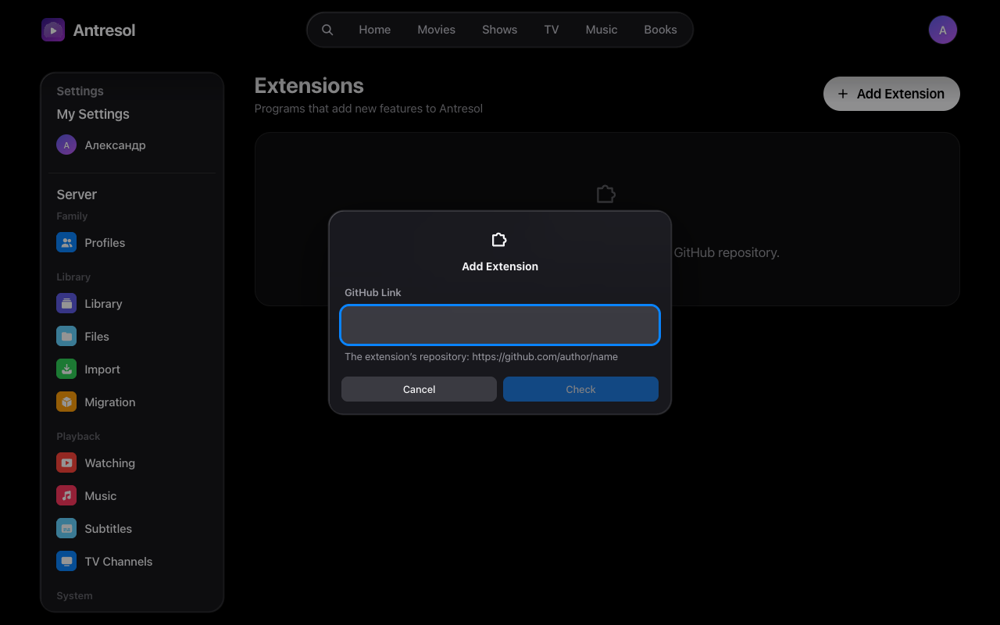

# Installing extensions

An extension is a separate program that adds features to Antresol, such as watching online or
trailers. The administrator installs extensions in the interface, without restarting the server.

## Install

1. **Settings → Server → Extensions → Add Extension.**
2. Paste the extension's GitHub repository link, for example
   `https://github.com/antresol-app/antresol-addon-online`.
3. Click **Check**, look at what access it asks for, and click **Install**.

An extension runs on the server with the same rights as Antresol. Install only ones you trust.

## Where their settings are

An extension's pages appear under **Settings → Server**, in "Downloads & Sources" or next to
related settings. Each extension's README has the details.

## The project's extensions

All Antresol extensions live in the [github.com/antresol-app](https://github.com/antresol-app)
organisation, as `antresol-addon-…` repositories. Each README has a setup guide in English and
Russian.

- [Online](https://github.com/antresol-app/antresol-addon-online): films and series without
  downloading. Needs a [helper service](addon-services.html).
- [Trailers](https://github.com/antresol-app/antresol-addon-trailers): trailers on film and series
  pages.
- The downloads extension: finds and fetches new films and series from sources you connect. It
  also needs a [helper service](addon-services.html) for sites with bot protection. Its link is in
  the organisation's repository list.

## Update or remove

- Extension updates are in **Settings → Server → Health → Versions and Updates** (see
  [Health and updates](updates.html)).
- An extension can ask for a newer Antresol than yours. Then it is not installed or updated, and
  the page says "Server version X or newer is needed — update the server". Update the server first
  (see [Health and updates](updates.html)); the extension you have keeps working until then. If you
  roll the server back to an older version, an installed extension that needs a newer one stops
  with the same message, and starts again when the server is new enough.
- Remove: **Extensions → ⋯ → Remove**. Its data stays unless you tick "Remove its data too".
- An extension's log: **Extensions → ⋯ → Log**.
