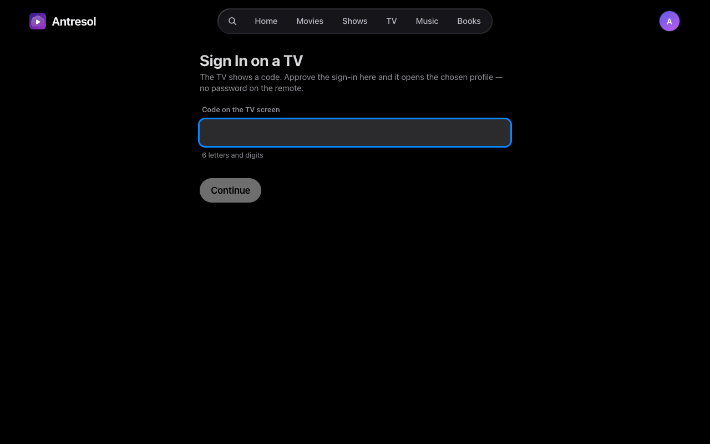

# Apps and TV sign-in

Every app connects to your own server. [Install the server](install.html) first.

## Browser

Nothing to install. At home, open `http://antresol.local:8420` on any computer, phone or TV with
a browser.

## Android and Android TV

One app for phones, tablets and TVs. It is in closed testing on Google Play:

1. Join the [antresol-test](https://groups.google.com/g/antresol-test) group.
2. With the same Google account, accept the invitation:
   [play.google.com/apps/testing/app.antresol.mobile](https://play.google.com/apps/testing/app.antresol.mobile).
3. Install Antresol from Google Play. Updates come from there too.

## iPhone, iPad, Mac and Apple TV

Beta in TestFlight. For an invitation, open an
[issue](https://github.com/antresol-app/antresol/issues/new) with your Apple ID's e-mail address.

## How an app finds the server

At home, by itself: the server shows up in the list on first launch. Away from home, enter the
server's [public address](public-address.html).

If an app at home does not see the server, see [Troubleshooting](troubleshooting.html#apps-do-not-find-the-server).

## Signing in on a TV

No typing passwords with a remote:

1. Open Antresol on the TV. It shows a QR code and a 6-character code.
2. Scan the QR code with the phone's camera. Or open `http://<server>:8420/pair` on the phone and
   enter the code.
3. Confirm: the TV opens the chosen profile.

## Devices

The apps and browsers a profile is signed in on are listed in **Settings → My Settings → Apps &
Devices → Devices**. Any of them can be signed out with **Sign Out on Device**: it asks to sign in
again.

The administrator sees every profile's devices: **Settings → Server → Profiles → Devices of All
Profiles**.

## The calendar of new episodes

Mark a series "Watching" or "Want to watch" and its new episodes show up in the **Calendar**. Open
it with the **Calendar** button in the header of the **Shows** section, or from the **Coming up**
shelf on Home. The calendar shows a week or a month; "available" is next to episodes you can
already watch.

## Music apps and book readers

Antresol speaks Subsonic (music) and OPDS (books).

1. **Settings → My Settings → Apps & Devices → App Password**: create a password.
2. In the app, enter the server's address, the profile name and this password.
   For readers the catalogue address is `http://<server>:8420/opds`.
