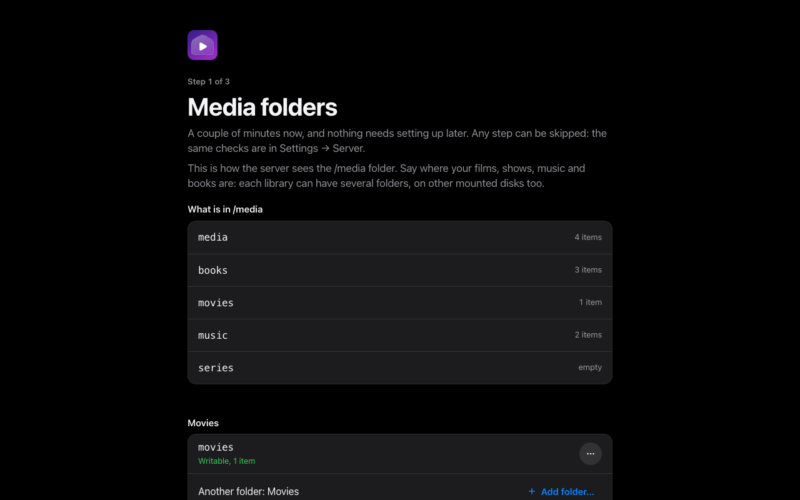
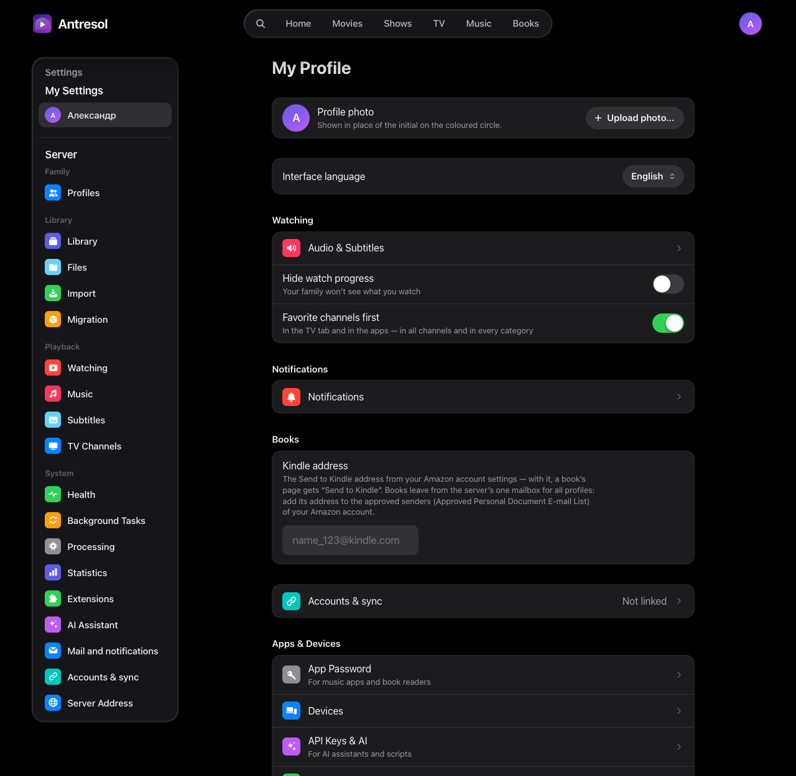
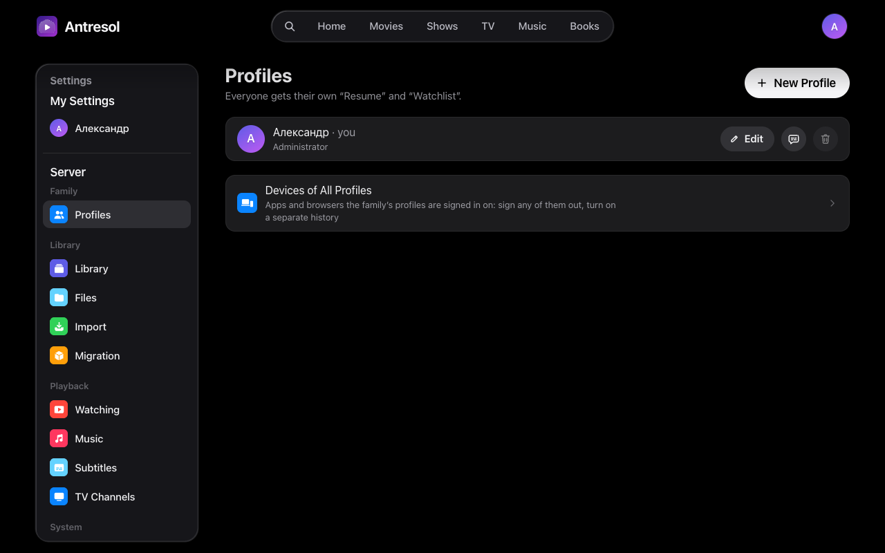

# First setup

After you create the administrator, a three-step wizard opens. Every step can be skipped: the
same checks stay in the server settings.

## Step 1. Media folders

The wizard shows what the server sees under `/media` and finds your films, series, music and
books.

- If a folder has another name, pick it from the list.
- One library can have several folders, on other disks too.
- **Create** makes a missing folder.

The server restarts for a few seconds after you choose.

## Step 2. Write access

The server needs to write to the media folder: subtitles and temporary files go there. If it
cannot, the wizard shows a ready command: copy it and run it on the computer.

## Step 3. Graphics card

The wizard shows whether a graphics card was found, and if not, what to uncomment in
`compose.yml`.

**Done** starts the first scan. Films appear within a few minutes.

## Where the settings are

Click your avatar → **Settings**. There are two parts on the left:

- **My Settings**: interface language, audio and subtitles, notifications, Kindle address, app
  password, your own devices. Each profile has its own.
- **Server**: everything only the administrator sees: profiles, library, watching, TV channels,
  health and background tasks, processing, mail, extensions, the server's address.

## Family profiles

**Settings → Server → Profiles → New Profile.**

- An adult profile can have a password. A profile without one opens only from the home network.
- A kid profile sees only what suits its age.

