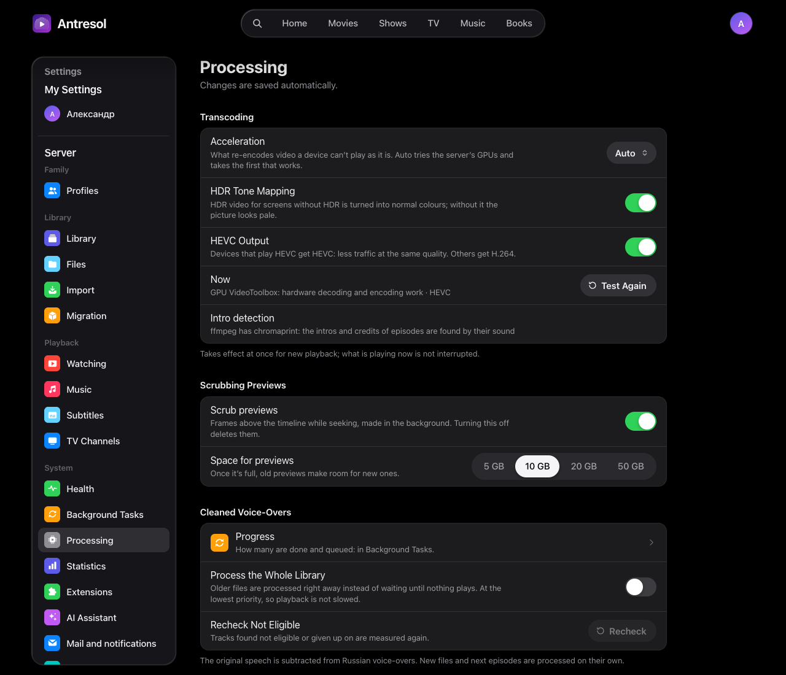

# Hardware transcoding

When a device cannot play a file as it is, the server transcodes the video. A graphics card does
it many times faster than the processor. The image already has the Intel and AMD drivers; the
container only needs to be given the card.

## Intel or AMD

1. Uncomment the `devices` block in `compose.yml`.
2. Run `docker compose up -d`.

If `compose.yml` sets `user:`, also uncomment `group_add` and put the device's group number there:
`ls -ln /dev/dri/renderD128` (fourth column).

## NVIDIA

1. Install the
   [NVIDIA Container Toolkit](https://docs.nvidia.com/datacenter/cloud-native/container-toolkit/latest/install-guide.html)
   on the computer. Check: `docker run --rm --gpus all ubuntu nvidia-smi`.
2. Uncomment the `deploy` block in `compose.yml`.
3. Run `docker compose up -d`.

## Check

**Settings → Server → Processing → Transcoding.** The "Now" line shows which card is working, or
why there is none, with a ready fix. The same, in short, is under **Settings → Server → Health →
Graphics Card**.

There you can also:

- pick the acceleration by hand (Auto, Intel Quick Sync, VA-API, NVIDIA, Off);
- pick the card when there are several;
- turn HDR tone mapping on or off (without it HDR looks washed out on a normal screen);
- turn HEVC on or off for apps that play it;
- click **Test Again** after a fix.

If the card gives up on a file, transcoding carries on on the processor by itself.

## If the card failed its test

| What the page says | What to do |
| --- | --- |
| No access to `/dev/dri/renderD128` | Add the group number the page shows to `group_add`. `docker compose up -d`, **Test Again**. |
| The container does not see `/dev/dri/...` | Uncomment `devices`. On the computer, `ls /dev/dri` must list `renderD*`; if not, the kernel has no driver or the device is not passed into the virtual machine. |
| The graphics driver did not load | Name the driver in `.env`: `LIBVA_DRIVER_NAME=iHD` (newer Intel), `i965` (Intel before 2014) or `radeonsi` (AMD). |
| No NVIDIA driver in the container | Install the NVIDIA Container Toolkit and uncomment `deploy`. |
| The driver refused the encoder | The card cannot do this mode. Pick another under "Acceleration" (VA-API for Intel) or keep the processor. |
| The test did not finish in 20 seconds | The card is busy or the driver hung. **Test Again**. |

## In .env

Until something is changed on that page, `VAULT_HWACCEL` (`auto`, `qsv`, `vaapi`, `nvenc`,
`videotoolbox`, `none`) and `VAULT_HWACCEL_DEVICE` (for example `/dev/dri/renderD129`) apply.
**Use Startup Settings** puts their values back.

## What else is in Processing

The same page holds everything the server does to your files in the background:

- **Scrubbing Previews**: the pictures above the timeline when you seek. **Space for previews** is
  how much disk they may take (5–50 GB); when it runs out, old ones make room for new ones.
- **Cleaned Voice-Overs**: the original speech is subtracted from the Russian voice-over. New files
  and next episodes are processed by themselves; **Process the Whole Library** takes the old ones
  too, at the lowest priority, so playback does not slow down.

How much is already done is on the **Background Tasks** page
([Health and updates](updates.html#what-the-server-does-in-the-background)).
