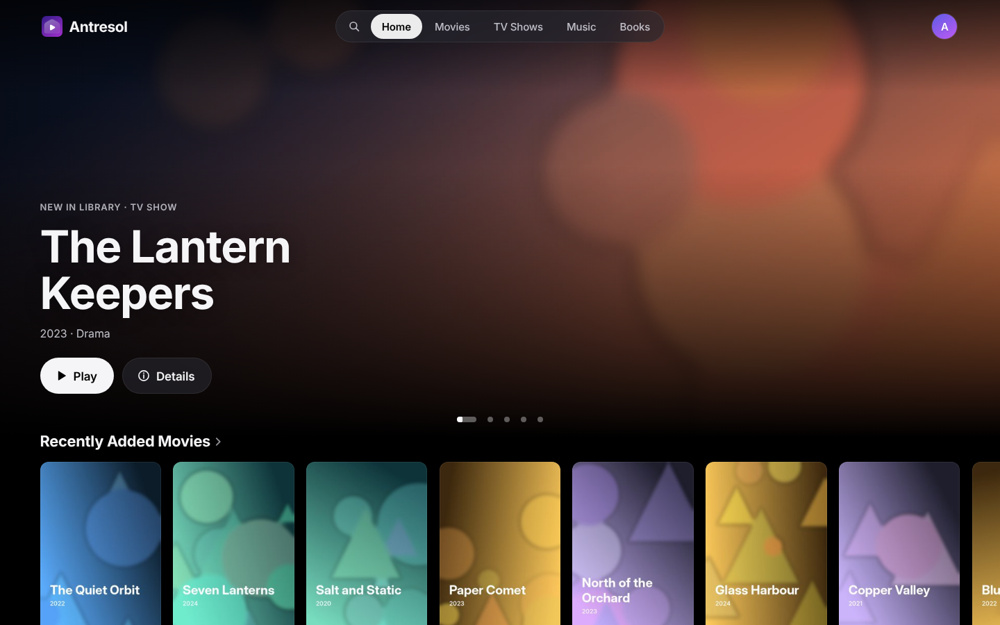

# Your media library, on all your devices

Antresol is a home media server for the films, series, music, audiobooks, books and comics you already have. Point it at your folders, open it in a browser, and the whole family gets one library with profiles, progress that follows you between devices, and a player that works at home and away.

<a class="btn" href="install.html">Install the server</a><a class="btn secondary" href="apps.html">Get the apps</a>

## What it does

- **Films and series** with posters, descriptions, cast and seasons; audio tracks, subtitles, skipping recaps, intros and credits; hardware transcoding when the host has a GPU.
- **TV channels** made from your own library, plus your IPTV playlists, with a programme guide.
- **Music** with playlists, synced lyrics and a Subsonic API for music apps.
- **Books, audiobooks, manga and comics** with readers, chapters, a sleep timer and an OPDS catalogue.
- **Profiles** for the household, kid profiles with age limits, screen time.
- **Apps** for Android phones and TV, iPhone, iPad, Mac and Apple TV, and the web interface built into the server.

## How it works

The server runs on your own computer or NAS and shows the files you put there. The apps connect only to your server. No content is provided, and the developer receives none of your data. Only add media you have the rights to.

The server and its web interface are open source: [github.com/antresol-app/antresol](https://github.com/antresol-app/antresol).
