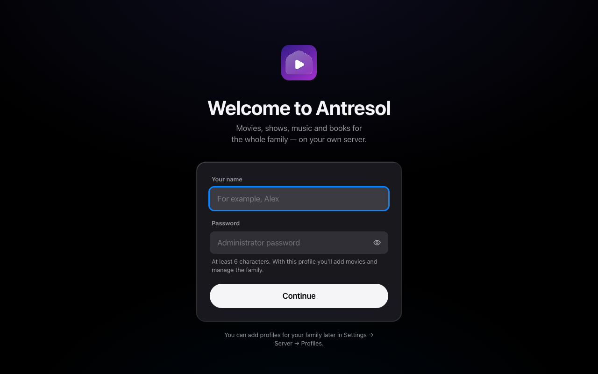

# Install

Antresol runs in Docker on any Linux computer or NAS. Installing takes about ten minutes.

**You need**

- Linux with Docker and Docker Compose.
- A folder with your films, series, music or books.
- A free [TMDB](https://www.themoviedb.org/settings/api) API key, for posters and descriptions.

## Media folders

Put your files in one folder, one subfolder per kind of media:

```
/srv/media/
  movies/      Film Title (2019)/Film Title (2019).mkv
  series/      Series Title/Season 01/Series Title S01E01.mkv
  music/       Artist/2019 - Album/01 - Track.flac
  books/
    ebooks/      Author - Title.epub
    audiobooks/  Author - Title/*.mp3  (or one .m4b)
    manga/       Series/Volume 01.cbz
```

If your folders already have other names, don't rename anything: on the first run you pick
which is which. More in [Folders and files](library.html).

## Download compose.yml and .env

```sh
mkdir ~/antresol && cd ~/antresol
curl -fsSLO https://raw.githubusercontent.com/antresol-app/antresol/main/compose.yml
curl -fsSL https://raw.githubusercontent.com/antresol-app/antresol/main/.env.example -o .env
```

## Fill in .env

Open `.env` (for example `nano .env`) and set three lines:

```sh
MEDIA_DIR=/srv/media          # the media folder on this computer
VAULT_TMDB_KEY=your-tmdb-key
TZ=Europe/Berlin              # your time zone
```

Leave the rest as it is. The full list is in [All .env settings](configuration.html).

## Start

```sh
docker compose up -d
```

Open `http://antresol.local:8420` or `http://<computer's IP>:8420` in a browser and choose the
administrator's name and password. Do this at one of these addresses, not through a reverse
proxy's name: the first setup is accepted only from the home network, and a name that is not an
IP address, a home name (`*.local`, `*.lan`, a single word) or the server's saved
[public address](public-address.html) does not count as home.



The [first setup](first-setup.html) opens next.

## Graphics card

If the computer has an Intel, AMD or NVIDIA graphics card, uncomment its lines in `compose.yml`
and run `docker compose up -d`. Details: [Hardware transcoding](hardware-transcoding.html).

## Next

- [First setup](first-setup.html): folders, permissions, family profiles.
- [Apps](apps.html): phones, tablets and TVs.
- [Public address](public-address.html): reaching the server from the internet.
- [Troubleshooting](troubleshooting.html): if something did not start.
