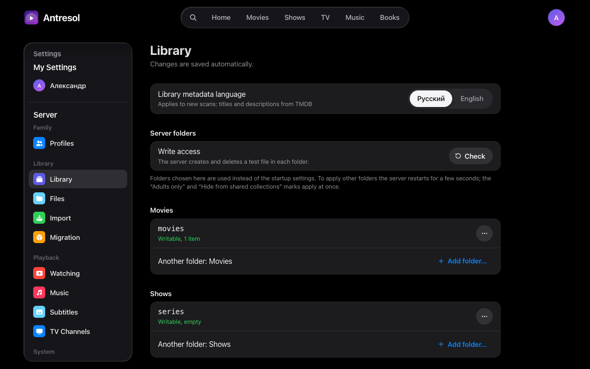
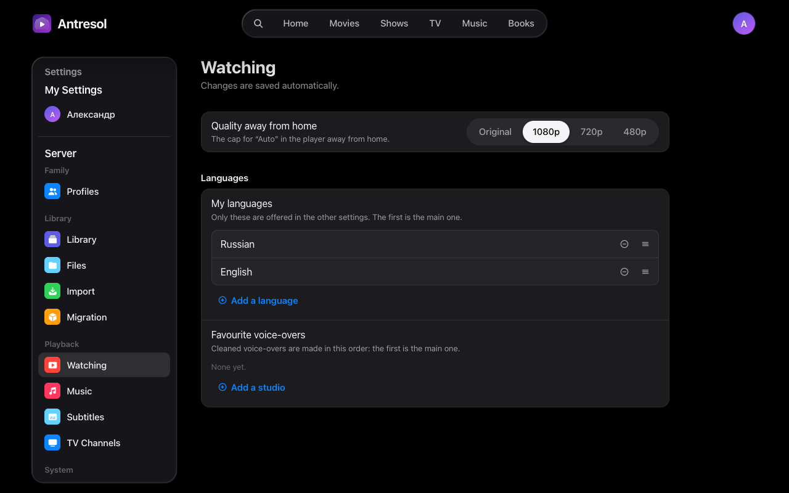

# Folders and files

## Naming files

| What | Example |
| --- | --- |
| Film | `movies/Interstellar (2014)/Interstellar (2014).mkv` |
| Series | `series/Dark/Season 01/Dark S01E01.mkv` |
| Music | `music/Artist/2019 - Album/01 - Track.flac` |
| Book | `books/ebooks/Author - Title.epub` |
| Audiobook | `books/audiobooks/Author - Title/*.mp3` or one `.m4b` |
| Manga and comics | `books/manga/Series/Volume 01.cbz` |

The year in brackets helps find the right film. A poster and a backdrop can sit beside it:
`poster.jpg` and `fanart.jpg`.

## Your own folder names

**Settings → Server → Library → Server folders.**

- Pick which folder holds what. Each library can have several folders.
- Folders are inside the media folder that `compose.yml` mounts as `/media`.



The same folders can be set in `.env` (`MOVIES_DIR`, `SERIES_DIR` and the others), but the choice
made in the interface wins.

## Scanning

The server checks the folders every 15 minutes by itself. To not wait:
**Library → Scanning → Rescan library** (the **Start** button).

## Description language

**Library → Library metadata language**: the language of titles and descriptions from TMDB. It
applies to new scans.

## Languages and voice-overs

**Settings → Server → Watching.**

- **My languages**: the languages the other settings offer. The first is the main one.
- **Favourite voice-overs**: the order cleaned voice-overs are made in; the first is the main one.
  The row is there while Russian is among My languages.
- **Quality away from home**: the cap on video quality away from home
  ([details](public-address.html#what-is-different-away-from-home)).



## Temporary files on another disk

Playback segments and channel streams live in `tmp/antresol-hls` inside the media folder. To move
them, for example to a fast disk at `/scratch`:

1. Create the folder and let uid 1000 write to it:
   `sudo mkdir -p /scratch/antresol-hls && sudo chown 1000:1000 /scratch/antresol-hls`.
2. Next to `compose.yml`, create `compose.override.yml`:

   ```yaml
   services:
     antresol:
       environment:
         VAULT_TRANSCODE_DIR: /transcode
       volumes:
         - /scratch/antresol-hls:/transcode
   ```

3. Run `docker compose up -d`.

## Paths: host and container

The server runs in a container and sees the media folder as `/media`. The only host path in `.env`
is `MEDIA_DIR`. Every `VAULT_*_DIR` variable is a path inside the container: `/tank/media/...`
does not exist there.
