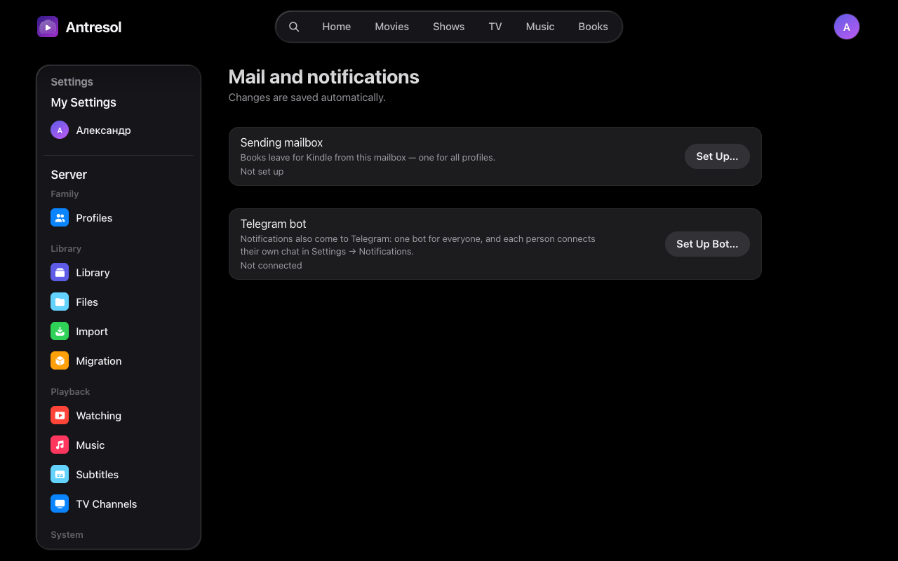
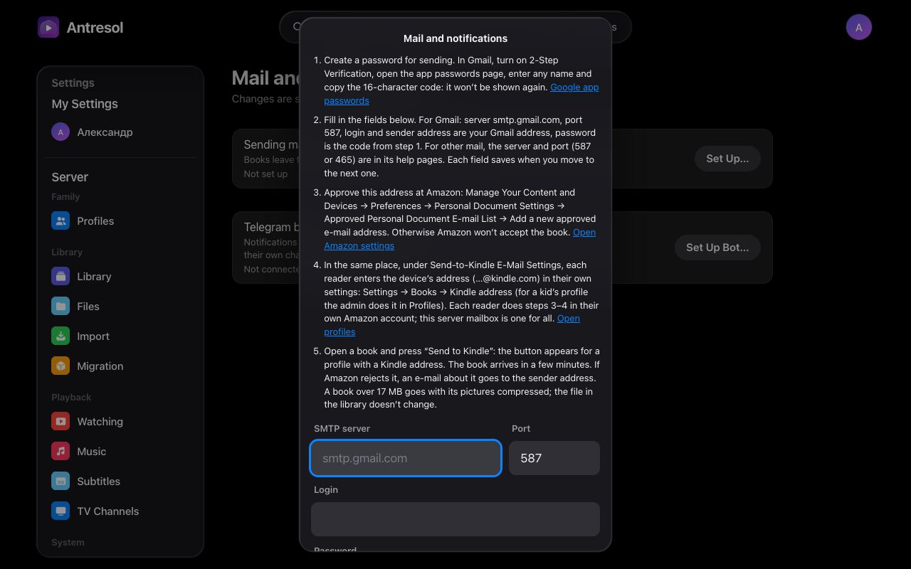
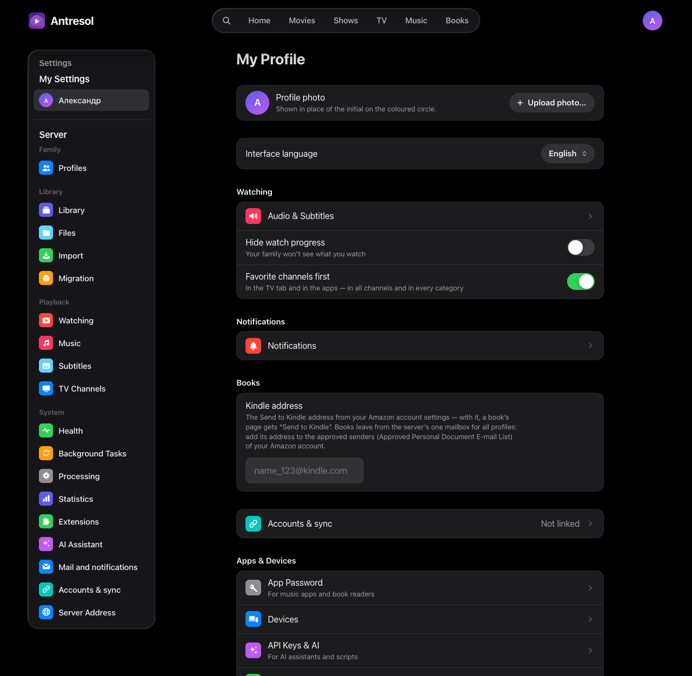

# Mail, Kindle and Telegram

Mail is used for two things: notifications and sending books to a Kindle. Telegram is another way
to get notifications. The administrator sets up the sending mailbox and the Telegram bot once, in
**Settings → Server → Mail and notifications**.

## Sending mailbox

Click **Sending mailbox → Set Up…** and fill in the fields. Any SMTP mailbox works:

| Service | Server | Port | Login | Password |
| --- | --- | --- | --- | --- |
| Gmail | `smtp.gmail.com` | 587 | your Gmail address | an [app password](https://myaccount.google.com/apppasswords) |
| Resend | `smtp.resend.com` | 587 | `resend` | an API key |
| Other mail | in its help | 587 or 465 | usually the address | usually an app password |

For Gmail, turn on 2-step verification first, or no app password can be made.

## Books to a Kindle

There is one sending mailbox for the whole server, and each person has their own Kindle address.

**Once, the administrator:** set up the sending mailbox (above).

**Each reader:**

1. At Amazon, in your own account, approve the sender address shown under "Sending mailbox":
   **Manage Your Content and Devices → Preferences → Personal Document Settings → Approved Personal
   Document E-mail List**.
2. On the same page, copy the Kindle's address (`…@kindle.com`) into **Settings → My Settings →
   Books → Kindle address**. It is saved when you leave the field.
3. Open a book and click **Send to Kindle**: the button is there for a profile that has a Kindle
   address.

A kid profile's address is entered by the administrator: **Settings → Server → Profiles → Edit**.

The book arrives within minutes. Books over 17 MB are sent with compressed pictures.

## Telegram

**Once, the administrator:**

1. In Telegram, open [@BotFather](https://t.me/BotFather), send `/newbot` and choose a name.
2. Paste the token in **Telegram bot → Set Up Bot…** and click **Check**.

**Each profile:** **Settings → My Settings → Notifications → Connect Telegram**, open the link and
press "Start" in Telegram.

Telegram needs no public address and no open port. For links to films in the messages, set a
[public address](public-address.html).

## Which notifications arrive

Each person chooses in **Settings → My Settings → Notifications**, and confirms their e-mail
address there. Until something is turned on, nothing is sent. Nothing arrives between 22:00 and
08:00.
