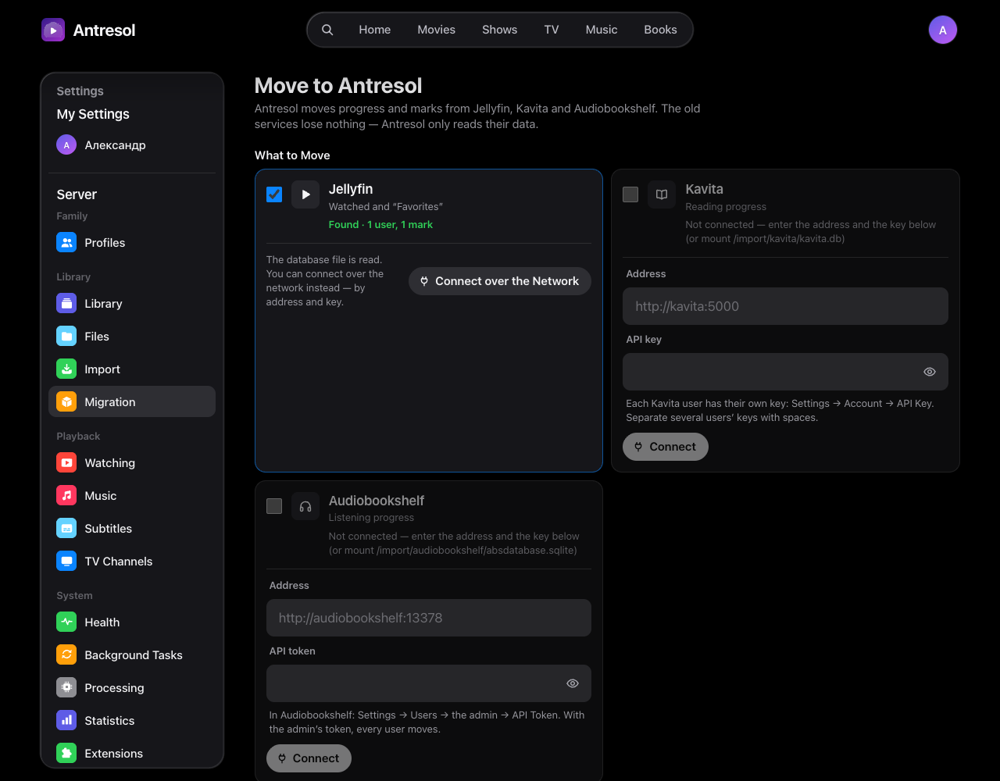

# Moving from Jellyfin, Kavita and Audiobookshelf

Antresol brings over what you watched and your favourites from Jellyfin, what you read from
Kavita and what you listened to in Audiobookshelf. The old services lose nothing: Antresol only
reads their data.



## 1. Connect the old services

Open **Settings → Server → Migration** and wait until Antresol has scanned the library. Each
service has its own card. The easiest way is to connect over the network:

1. Enter the service's **Address** as Antresol sees it: the computer's address on your network and
   the port, for example `http://<computer's address>:8096`. `localhost` will not do: for the
   container it is the container itself.
2. Enter a key:

   | Service | What it needs |
   | --- | --- |
   | Jellyfin | An API key: **Dashboard → API Keys → "+"**. With it, every user moves. Or a name and password: a Jellyfin administrator moves every user, anyone else only themselves. |
   | Kavita | Each user has their own key: **Settings → Account → API Key**. Enter several users' keys separated by spaces. |
   | Audiobookshelf | The administrator's API token: **Settings → Users → the admin → API Token**. With it, every user moves. |

3. Click **Connect**. The server checks the address and the key and shows what it found:
   "Connected · …".

The server keeps the key and the password in memory only: they are never written to disk, and a
restart forgets them. **Forget** removes the connection sooner.

### If the network will not do: the database file

Antresol can also read the databases themselves from `/import` inside the container:

| Service | The file it needs |
| --- | --- |
| Jellyfin | `/import/jellyfin/jellyfin.db` |
| Kavita | `/import/kavita/kavita.db` |
| Audiobookshelf | `/import/audiobookshelf/absdatabase.sqlite` |

Mount the folders holding these files in `compose.override.yml` next to `compose.yml` (the paths
on the left are yours):

```yaml
services:
  antresol:
    volumes:
      - /opt/jellyfin/config/data:/import/jellyfin
      - /opt/kavita/config:/import/kavita
      - /opt/audiobookshelf/config:/import/audiobookshelf
```

Then `docker compose up -d`. The service's card shows "Found · …". The file is read while the
service is not connected over the network; a network connection wins.

## 2. Check and move

1. Tick the services you want to move.
2. Pick an Antresol profile for each old user.
3. Click **Check**: a report shows what will move. Nothing changes yet.
4. Click **Move**.

Newer progress in Antresol is never overwritten. You can run it again: what already moved is not
repeated.

## 3. Remove the connection

When everything has moved, click **Forget** on the connected cards. If you mounted database files,
delete the `/import/...` lines from `compose.override.yml` and run `docker compose up -d`.
