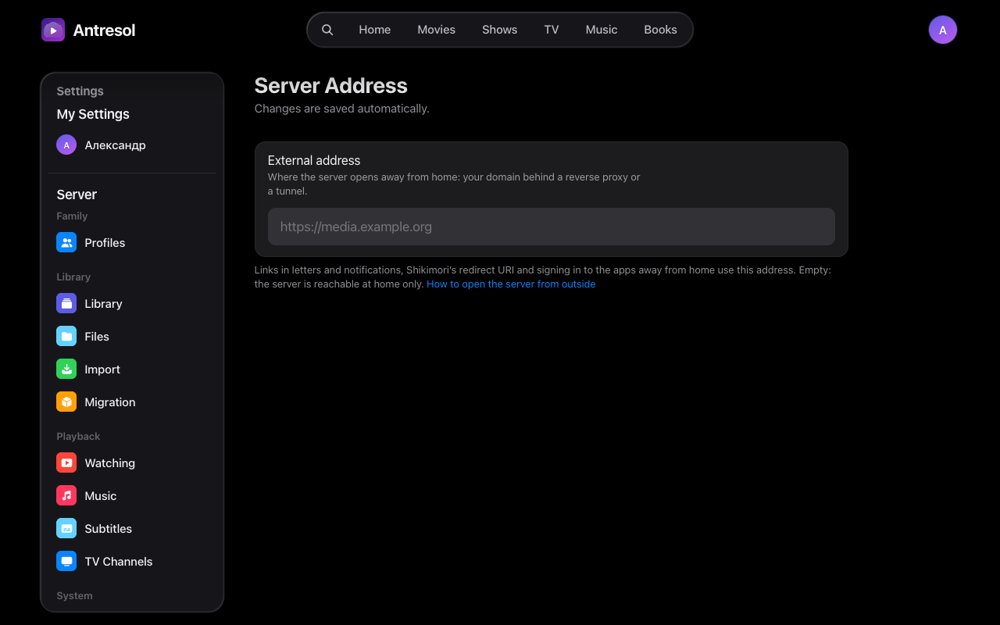

# Public address and remote access

At home there is nothing to set up: the apps find the server by themselves. This page is about
opening the server to the internet and telling it its address.

## What the public address is

It is the address the server opens at from outside, such as `https://media.example.com`. Set it
in the interface: **Settings → Server → Server Address → External address**. No slash at the end.
It is saved at once, and the server needs no restart.



The same address can be set in `.env` as `VAULT_PUBLIC_URL=https://media.example.com`. That wins:
the field then shows this address with "Set on the server (VAULT_PUBLIC_URL)" under it, and it can
be changed only in `.env`.

The server uses this address:

- in links in e-mails and Telegram messages;
- for signing in to Shikimori (the redirect address; it needs HTTPS);
- in the apps: once connected at home, they also remember the outside address;
- in extensions that need the server's address.

The address alone does not open the server to the internet. That takes a reverse proxy.

## Opening the server to the internet

You need a domain (or a free subdomain from DuckDNS and the like), ports 80 and 443 forwarded on
the router, and a reverse proxy with HTTPS: Caddy, Nginx Proxy Manager, Traefik or nginx.

### 1. Set up the proxy

The proxy takes HTTPS and passes requests to `http://<computer running Antresol>:8420`.
For Caddy (it gets the certificate by itself):

```
media.example.com {
    reverse_proxy 127.0.0.1:8420
}
```

For nginx:

```nginx
location / {
    proxy_pass http://127.0.0.1:8420;
    proxy_set_header Host $host;
    proxy_set_header X-Forwarded-For $proxy_add_x_forwarded_for;
    proxy_set_header X-Forwarded-Proto $scheme;
    proxy_buffering off;
    client_max_body_size 0;
}
```

The `X-Forwarded-For` and `X-Forwarded-Proto` headers are required: they tell the server who came
and whether over HTTPS. Caddy, Nginx Proxy Manager and Traefik send them by themselves.

### 2. Tell the server the proxy is yours

Otherwise the server does not believe the proxy's headers and treats every request as remote,
even from home.

1. Open the server through the proxy.
2. Look at the log: `docker compose logs antresol | grep VAULT_TRUSTED_PROXIES`.
   It holds a line like `request from 172.18.0.1 carries X-Forwarded-For ... does not list it`.
3. Put that address in `.env`:

   ```sh
   VAULT_TRUSTED_PROXIES=172.18.0.1
   ```

Several addresses or subnets go comma-separated.

### 3. Set the address

Put it in **Settings → Server → Server Address**. If you set it in `.env`
(`VAULT_PUBLIC_URL=https://media.example.com`), run `docker compose up -d` afterwards.

Check from a phone on mobile data: `https://media.example.com` should open.

At home the server counts a visitor as home only when they reach it by an IP address, by this
address's name or by a name only a home network has (`antresol`, `*.local`, `*.lan`,
`*.home.arpa`). Any other name that points at the server from inside, say a second domain on
your own DNS, is treated as away from home until you list it in `VAULT_TRUSTED_HOSTS`
(`media.lan,*.example.org`); the log says so once.

## What is different away from home

- Profiles **without a password** sign in only from the home network. Give a password to those who
  will watch away from home.
- Video quality away from home is capped so the connection keeps up:
  **Settings → Server → Watching → Quality away from home**. For music:
  **Settings → Server → Music → Music away from home**.

## No open ports: a VPN

If you'd rather not open the server to the internet, use a VPN such as Tailscale or WireGuard.
For the server to treat the VPN as home, add its subnet:

```sh
VAULT_TRUSTED_NETS=100.64.0.0/10
```

Then the external address can be the server's address on the VPN.
