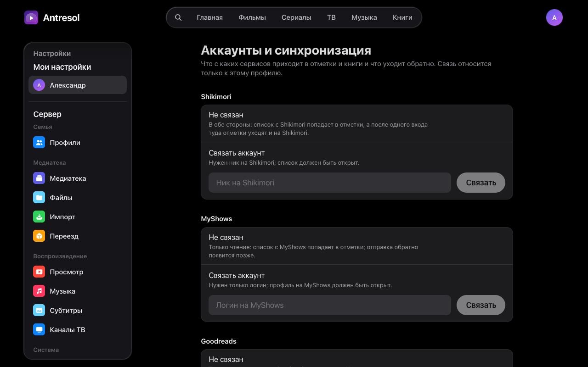

# Shikimori, MyShows и Goodreads

Antresol забирает ваши отметки с этих сервисов: что вы уже посмотрели и прочитали. С Shikimori
отметки могут уходить и обратно.

Каждый профиль связывает свои аккаунты сам:
**Настройки → Мои настройки → Аккаунты и синхронизация**.

## Shikimori

1. Откройте свой список на Shikimori (настройки приватности на сайте).
2. Введите ник и нажмите **Связать**. Список придёт в отметки.
3. Чтобы отметки уходили и на Shikimori, включите **Отмечать и на Shikimori** и один раз войдите
   на сайте.

Пункт 3 работает, только если администратор настроил приложение Shikimori (ниже).

## MyShows

Введите логин и нажмите **Связать**. Профиль на MyShows должен быть открыт. Пока только чтение:
отметки приходят с MyShows, обратно не уходят.

## Goodreads

1. Вставьте адрес профиля, например `https://www.goodreads.com/user/show/12345`. Профиль и полки
   должны быть открыты.
2. Goodreads отдаёт только 100 последних книг. Всю историю загрузите файлом: на Goodreads
   «My Books → Import and export → Export Library», затем **Файл экспорта (CSV) → Выбрать файл**.

## Для администратора: запись на Shikimori

Чтобы профили могли отправлять отметки на Shikimori, серверу нужно своё приложение Shikimori и
[публичный адрес](public-address.html) с HTTPS.

1. Задайте внешний адрес: **Настройки → Сервер → Адрес сервера**, строка начинается с `https://`
   (подробнее — [Публичный адрес](public-address.html)).
2. Откройте **Настройки → Сервер → Аккаунты и синхронизация**. В поле **Адрес возврата** появится
   адрес для Shikimori.
3. Создайте приложение на [shikimori.one/oauth/applications](https://shikimori.one/oauth/applications). Укажите этот адрес как Redirect URI и scope
   `user_rates`.
4. Вставьте Client ID и Client Secret приложения в Antresol.

Если вместо адреса возврата написано, что внешний адрес сервера ещё не задан, нажмите **Задать
адрес сервера** (или откройте **Настройки → Сервер → Адрес сервера**), см.
[Публичный адрес](public-address.html).
