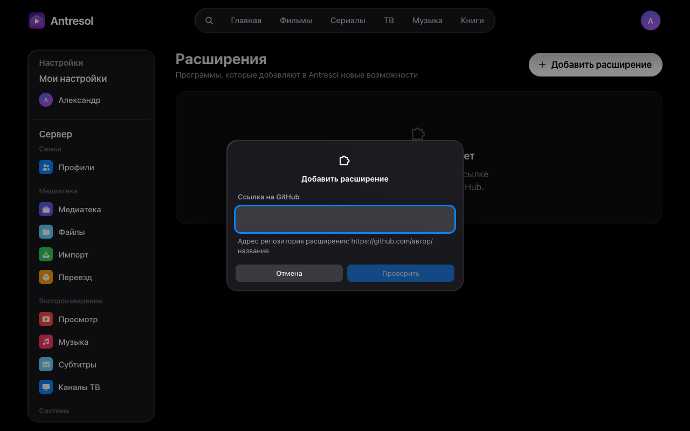

# Установка расширений

Расширение — отдельная программа, которая добавляет в Antresol новые возможности: например,
просмотр онлайн или трейлеры. Расширения ставит администратор, в интерфейсе, без перезапуска
сервера.

## Установить

1. **Настройки → Сервер → Расширения → Добавить расширение.**
2. Вставьте ссылку на репозиторий расширения на GitHub, например
   `https://github.com/antresol-app/antresol-addon-online`.
3. Нажмите **Проверить**, посмотрите, какой доступ просит расширение, и нажмите **Установить**.

Расширение работает на сервере с теми же правами, что и Antresol. Ставьте только те, которым
доверяете.

## Где их настройки

Страницы расширения появляются в **Настройки → Сервер**, в группе «Загрузки и источники» или
рядом с похожими настройками. Подробности о каждом расширении — в README его репозитория.

## Расширения проекта

Все расширения Antresol лежат в организации
[github.com/antresol-app](https://github.com/antresol-app): репозитории с именами
`antresol-addon-…`. В README каждого есть инструкция по настройке на русском и английском.

- [Онлайн](https://github.com/antresol-app/antresol-addon-online) — смотреть фильмы и сериалы
  без загрузки. Нужна [вспомогательная служба](addon-services.html).
- [Трейлеры](https://github.com/antresol-app/antresol-addon-trailers) — трейлеры на страницах
  фильмов и сериалов.
- Расширение загрузок — поиск и загрузка новых фильмов и сериалов по источникам, которые вы
  подключите. Ему тоже нужна [вспомогательная служба](addon-services.html) для сайтов с защитой
  от ботов. Ссылка — в списке репозиториев организации.

## Обновить или удалить

- Обновления расширений — в **Настройки → Сервер → Состояние → Версии и обновления** (см.
  [Состояние и обновления](updates.html)).
- Расширению может понадобиться более новый Antresol, чем у вас. Тогда оно не ставится и не
  обновляется, а на странице написано «Нужна версия сервера X или новее — обновите сервер».
  Сначала обновите сервер (см. [Состояние и обновления](updates.html)); установленное расширение
  до тех пор работает как работало. Если вернуть сервер к старой версии, установленное расширение,
  которому нужна новая, остановится с тем же сообщением и запустится снова, когда сервер подойдёт.
- Удалить: **Расширения → ⋯ → Удалить**. Данные расширения остаются, если не отметить
  «Удалить и данные».
- Журнал расширения: **Расширения → ⋯ → Журнал**.
