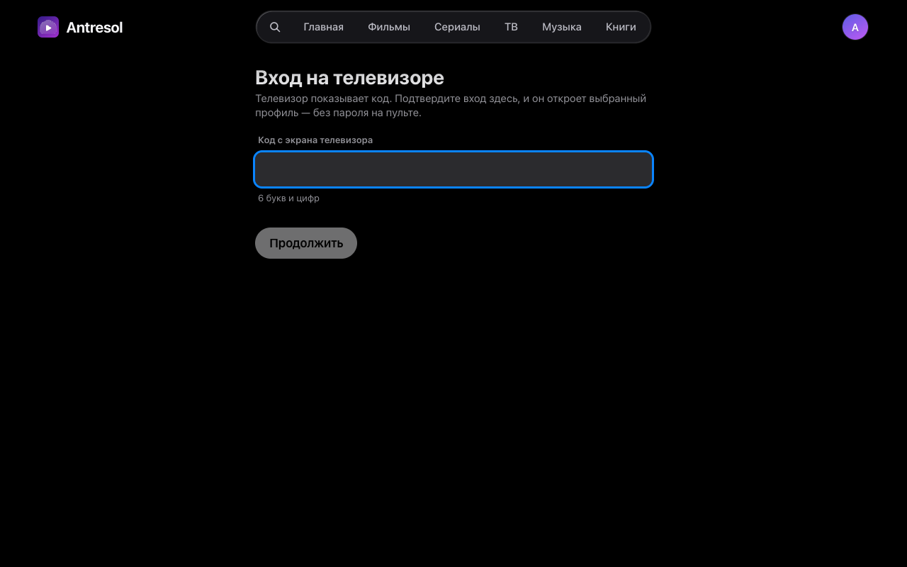

# Приложения и вход на ТВ

Каждое приложение подключается к вашему серверу. Сначала [установите сервер](install.html).

## Браузер

Ничего ставить не нужно. Дома откройте `http://antresol.local:8420` на любом компьютере,
телефоне или телевизоре с браузером.

## Android и Android TV

Одно приложение для телефонов, планшетов и телевизоров. Пока оно в закрытом тестировании
Google Play:

1. Вступите в группу [antresol-test](https://groups.google.com/g/antresol-test).
2. С того же аккаунта Google примите приглашение:
   [play.google.com/apps/testing/app.antresol.mobile](https://play.google.com/apps/testing/app.antresol.mobile).
3. Установите Antresol из Google Play. Обновления приходят оттуда же.

## iPhone, iPad, Mac и Apple TV

Бета в TestFlight. Чтобы получить приглашение, откройте
[issue](https://github.com/antresol-app/antresol/issues/new) с адресом своего Apple ID.

## Как приложение находит сервер

Дома — само: сервер появится в списке при первом запуске. Вне дома введите
[публичный адрес](public-address.html) сервера.

Если приложение дома сервер не видит, проверьте [Решение проблем](troubleshooting.html#приложения-не-видят-сервер).

## Вход на телевизоре

На телевизоре не нужно набирать пароль пультом:

1. Откройте Antresol на телевизоре. Он покажет QR-код и код из 6 букв и цифр.
2. Отсканируйте QR-код камерой телефона. Или откройте на телефоне `http://<сервер>:8420/pair`
   и введите код.
3. Подтвердите вход — телевизор откроет выбранный профиль.

## Устройства

Приложения и браузеры, в которые вошёл профиль, видны в **Настройки → Мои настройки → Приложения и
устройства → Устройства**. Любое можно разлогинить кнопкой **Выйти на устройстве**: оно попросит
войти заново.

Администратор видит устройства всех профилей: **Настройки → Сервер → Профили → Устройства всех
профилей**.

## Календарь выхода серий

Отметьте сериал «Смотрю» или «Хочу посмотреть», и его новые серии появятся в **Календаре**. Открыть
его можно кнопкой **Календарь** в шапке раздела **Сериалы** или ссылкой на полке **Скоро выйдет** на
Главной. Календарь показывает неделю или месяц; «доступно» стоит у серий, которые уже можно
смотреть.

## Музыкальные приложения и читалки

Antresol понимает Subsonic (музыка) и OPDS (книги).

1. **Настройки → Мои настройки → Приложения и устройства → Пароль для приложений** — создайте
   пароль.
2. В приложении укажите адрес сервера, имя профиля и этот пароль.
   Для читалок адрес каталога — `http://<сервер>:8420/opds`.
