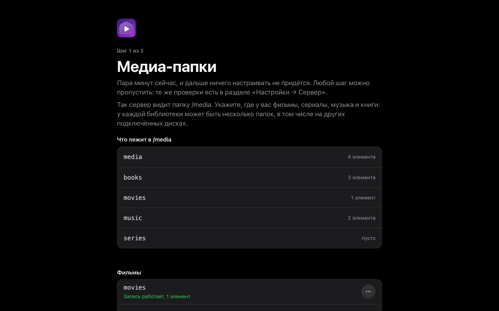
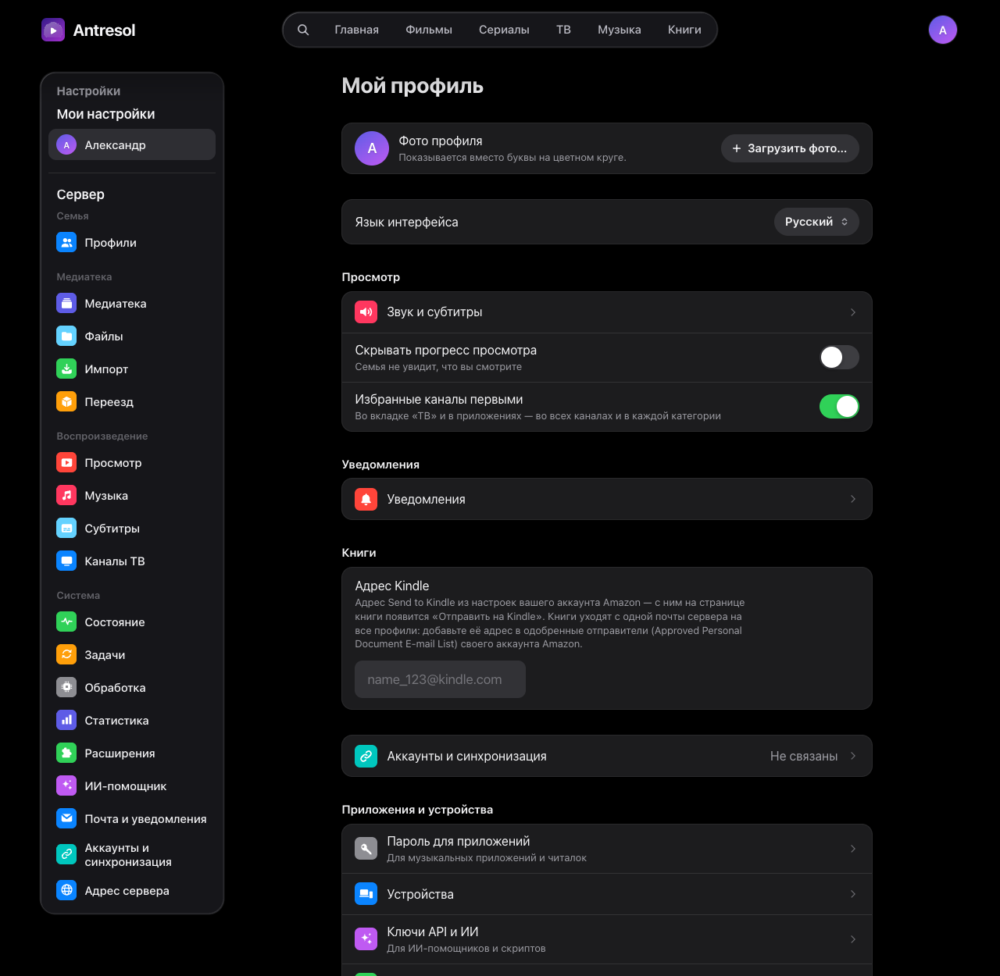
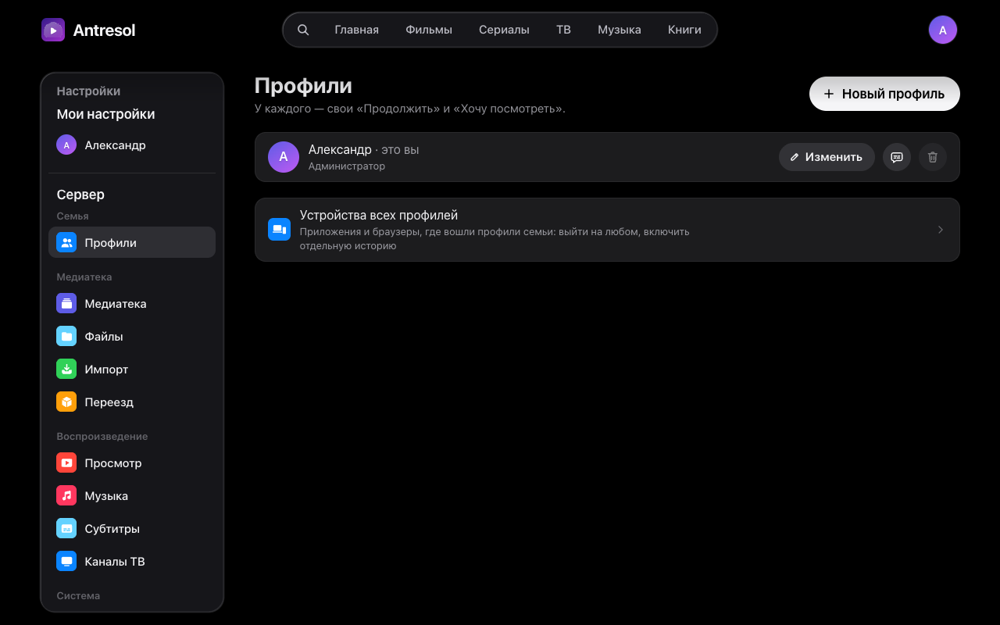

# Первая настройка

После создания администратора откроется мастер из четырёх шагов. Любой шаг можно пропустить:
те же проверки остаются в настройках сервера.

## Шаг 1. Медиа-папки

Мастер показывает, что сервер видит в `/media`, и находит папки с фильмами, сериалами,
музыкой и книгами.

- Если папка называется иначе, выберите её в списке.
- У одной библиотеки может быть несколько папок, в том числе на других дисках.
- Кнопка «Создать» делает недостающую папку.

После выбора сервер перезапускается на несколько секунд.

## Шаг 2. Права на запись

Серверу нужна запись в папку медиа: туда попадают субтитры и временные файлы.
Если записать не удалось, мастер покажет готовую команду — скопируйте её и выполните на компьютере.

## Шаг 3. Видеокарта

Мастер покажет, нашлась ли видеокарта. Если нет — что раскомментировать в `compose.yml`.

## Шаг 4. Внешние сервисы

Открытые сервисы, которые дополняют то, что уже есть в медиатеке: Wikidata (франшизы, оценки
Rotten Tomatoes), рейтинги IMDb, тексты песен (LRCLIB), заставки и титры (TheIntroDB, IntroDB).
У каждой строки написано, что сервис получает и что даёт; здесь все включены — выключите то, что не
нужно. См. [Внешние сервисы](configuration.html#external-services).

«Готово» сохраняет выбор и запускает первое сканирование. Фильмы появятся через несколько минут.

## Где настройки

Нажмите на свою аватарку → **Настройки**. Слева два раздела:

- **Мои настройки** — язык интерфейса, звук и субтитры, уведомления, адрес Kindle, пароль для
  приложений, свои устройства. У каждого профиля свои.
- **Сервер** — всё, что видит только администратор: профили, медиатека, просмотр, каналы ТВ,
  состояние и фоновые задачи, обработка, почта, расширения, адрес сервера.

## Профили семьи

**Настройки → Сервер → Профили → Новый профиль.**

- У взрослого профиля может быть пароль. Профиль без пароля открывается только из домашней сети.
- Детский профиль видит только то, что подходит по возрасту.
- Ребёнок может попросить фильм или сериал, которых нет в медиатеке («Попросить»; серверу нужен
  ключ TMDB). Вы отвечаете в **Настройки → Сервер → Запросы**: одобрите запрос и добавьте название
  в медиатеку любым способом, ребёнок увидит его, как только оно появится. Запросы выключает
  переключатель «Дети могут просить» вверху этой страницы.

