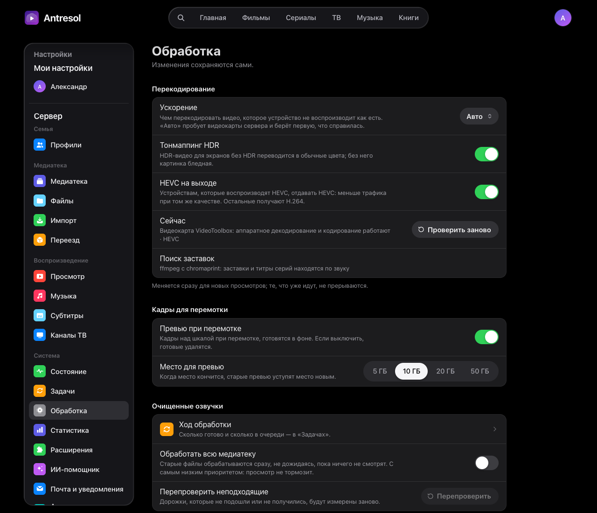

# Перекодирование на видеокарте

Если устройство не может воспроизвести файл как есть, сервер перекодирует видео. Видеокарта
делает это в разы быстрее процессора. Драйверы Intel и AMD уже в образе; контейнеру нужно только
дать видеокарту.

## Intel или AMD

1. В `compose.yml` раскомментируйте блок `devices`.
2. Выполните `docker compose up -d`.

Если в `compose.yml` задан `user:`, раскомментируйте и `group_add` и впишите номер группы
устройства: `ls -ln /dev/dri/renderD128` (четвёртый столбец).

## NVIDIA

1. Установите на компьютер
   [NVIDIA Container Toolkit](https://docs.nvidia.com/datacenter/cloud-native/container-toolkit/latest/install-guide.html).
   Проверка: `docker run --rm --gpus all ubuntu nvidia-smi`.
2. В `compose.yml` раскомментируйте блок `deploy`.
3. Выполните `docker compose up -d`.

## Проверить

**Настройки → Сервер → Обработка → Перекодирование.** Строка «Сейчас» показывает, какая
видеокарта работает, или почему её нет — с готовым исправлением. Коротко то же самое видно в
**Настройки → Сервер → Состояние → Оборудование**.

Там же можно:

- выбрать ускорение вручную (Авто, Intel Quick Sync, VA-API, NVIDIA, Выкл);
- выбрать видеокарту, если их несколько;
- включить или выключить тонмаппинг HDR (без него HDR на обычном экране выглядит бледным);
- включить или выключить HEVC для приложений, которые его умеют;
- нажать **Проверить заново** после исправления.

Если видеокарта отказалась от файла, перекодирование само продолжится на процессоре.

## Если видеокарта не прошла проверку

| Что пишет страница | Что сделать |
| --- | --- |
| Нет доступа к `/dev/dri/renderD128` | Добавьте в `group_add` номер группы, который показывает страница. `docker compose up -d`, **Проверить заново**. |
| Контейнер не видит `/dev/dri/...` | Раскомментируйте `devices`. На компьютере `ls /dev/dri` должен показывать `renderD*`; если нет — нет драйвера в ядре или устройство не проброшено в виртуальную машину. |
| Драйвер видеокарты не загрузился | Укажите драйвер в `.env`: `LIBVA_DRIVER_NAME=iHD` (новые Intel), `i965` (Intel до 2014) или `radeonsi` (AMD). |
| В контейнере нет драйвера NVIDIA | Установите NVIDIA Container Toolkit и раскомментируйте `deploy`. |
| Драйвер отказал кодировщику | Видеокарта не умеет этот режим. Выберите другой в «Ускорение» (для Intel — VA-API) или оставьте процессор. |
| Проверка не закончилась за 20 секунд | Видеокарта занята или драйвер завис. **Проверить заново**. |

## Через .env

Пока на странице ничего не меняли, действуют переменные `VAULT_HWACCEL` (`auto`, `qsv`, `vaapi`,
`nvenc`, `videotoolbox`, `none`) и `VAULT_HWACCEL_DEVICE` (например, `/dev/dri/renderD129`).
Кнопка **Как в настройках запуска** возвращает их значения.

## Что ещё в «Обработке»

Та же страница — всё, что сервер делает с вашими файлами в фоне:

- **Кадры для перемотки** — картинки над шкалой при перемотке. **Место для превью** — сколько
  диска на них отдать (5–50 ГБ); когда место кончится, старые уступят новым.
- **Очищенные озвучки** — из русской озвучки вычитается оригинальная речь. Новые файлы и
  следующие серии обрабатываются сами; **Обработать всю медиатеку** берёт и старые, с самым низким
  приоритетом: просмотр не тормозит.

Сколько уже готово — на странице **Задачи** ([Состояние и обновления](updates.html#что-сервер-делает-в-фоне)).
