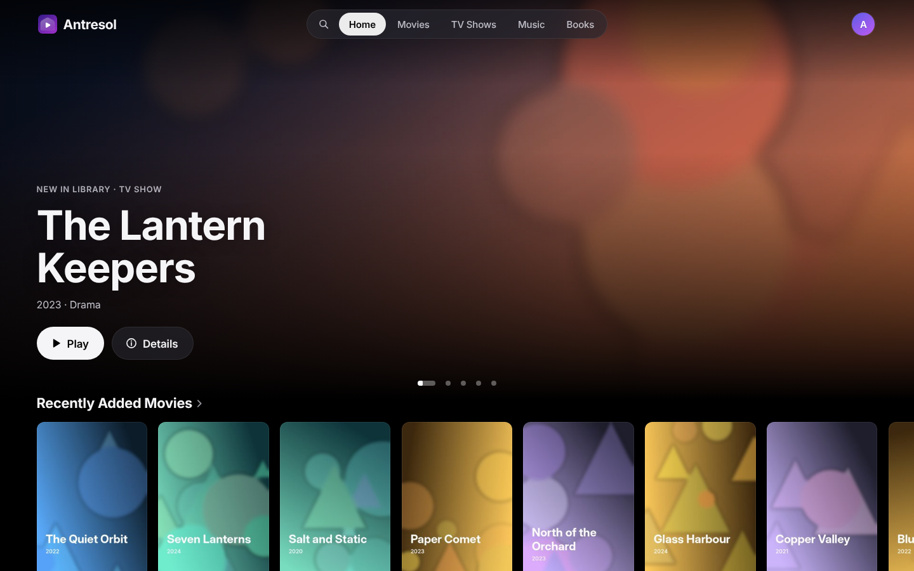

# Ваша медиатека на всех устройствах

Antresol — домашний медиасервер для ваших фильмов, сериалов, музыки, аудиокниг, книг и комиксов. Укажите папки, откройте сервер в браузере — и у всей семьи одна медиатека с профилями и прогрессом, который переходит между устройствами.

<a class="btn" href="install.html">Установить сервер</a><a class="btn secondary" href="apps.html">Приложения</a>

## С чего начать

  <a href="install.html"><strong>Установка</strong>Docker Compose за десять минут</a>
  <a href="first-setup.html"><strong>Первая настройка</strong>Папки, права, профили семьи</a>
  <a href="apps.html"><strong>Приложения</strong>Телефоны, планшеты, телевизоры</a>
  <a href="public-address.html"><strong>Доступ извне</strong>Публичный адрес и обратный прокси</a>
  <a href="tv.html"><strong>ТВ-каналы</strong>Каналы из медиатеки и IPTV</a>
  <a href="addons.html"><strong>Расширения</strong>Онлайн, трейлеры и другие</a>
  <a href="migrate.html"><strong>Переезд</strong>С Jellyfin, Kavita, Audiobookshelf</a>
  <a href="troubleshooting.html"><strong>Решение проблем</strong>Если что-то не работает</a>

Все разделы — в [документации](docs.html).

Antresol показывает только ваши файлы, контент не предоставляется.
