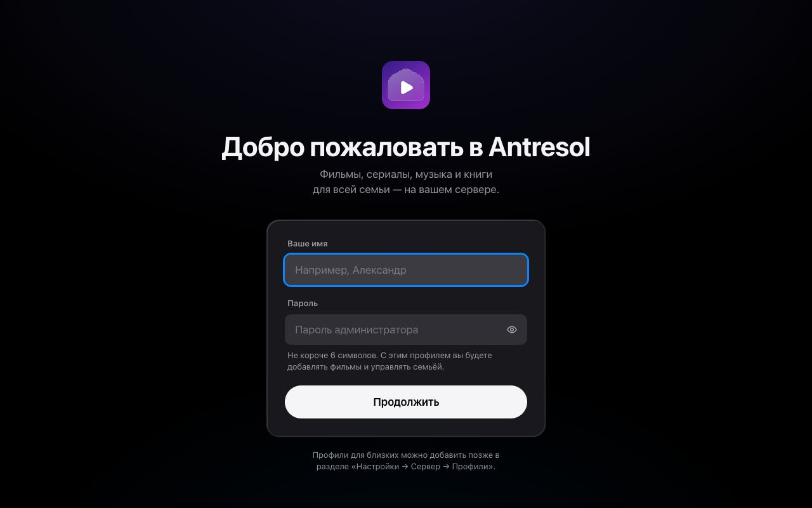

# Установка

Antresol работает в Docker на любом Linux-компьютере или NAS. Установка занимает минут десять.

**Что понадобится**

- Linux с Docker и Docker Compose.
- Папка с фильмами, сериалами, музыкой или книгами.
- Бесплатный ключ API [TMDB](https://www.themoviedb.org/settings/api) — для постеров и описаний.

## Папки медиатеки

Сложите файлы в одну папку, по подпапке на вид медиа:

```
/srv/media/
  movies/      Название фильма (2019)/Название фильма (2019).mkv
  series/      Сериал/Season 01/Сериал S01E01.mkv
  music/       Исполнитель/2019 - Альбом/01 - Трек.flac
  books/
    ebooks/      Автор - Название.epub
    audiobooks/  Автор - Название/*.mp3  (или один .m4b)
    manga/       Серия/Том 01.cbz
```

Если папки уже называются иначе, ничего не переименовывайте: на первом запуске вы укажете,
какая из них что. Подробнее — в разделе [Папки и файлы](library.html).

## Скачайте compose.yml и .env

```sh
mkdir ~/antresol && cd ~/antresol
curl -fsSLO https://raw.githubusercontent.com/antresol-app/antresol/main/compose.yml
curl -fsSL https://raw.githubusercontent.com/antresol-app/antresol/main/.env.example -o .env
```

## Заполните .env

Откройте `.env` (например, `nano .env`) и задайте три строки:

```sh
MEDIA_DIR=/srv/media          # папка с медиа на этом компьютере
VAULT_TMDB_KEY=ваш-ключ-tmdb
TZ=Europe/Moscow              # ваш часовой пояс
```

Остальные параметры можно не трогать. Полный список — в [Все параметры .env](configuration.html).

## Запустите

```sh
docker compose up -d
```

Откройте в браузере `http://antresol.local:8420` или `http://<IP компьютера>:8420`.
Придумайте имя и пароль администратора. Делайте это по одному из этих адресов, а не по имени
обратного прокси: первая настройка принимается только из домашней сети, а имя, которое не
является IP-адресом, домашним именем (`*.local`, `*.lan`, одно слово) или сохранённым
[внешним адресом](public-address.html) сервера, домом не считается.



Дальше откроется [первая настройка](first-setup.html).

## Видеокарта

Если в компьютере есть видеокарта Intel, AMD или NVIDIA, раскомментируйте её строки в
`compose.yml` и выполните `docker compose up -d`. Подробно — в
[Перекодирование на видеокарте](hardware-transcoding.html).

## Что дальше

- [Первая настройка](first-setup.html): папки, права, профили семьи.
- [Приложения](apps.html): телефоны, планшеты и телевизоры.
- [Публичный адрес](public-address.html): как открыть сервер из интернета.
- [Решение проблем](troubleshooting.html): если что-то не запустилось.
