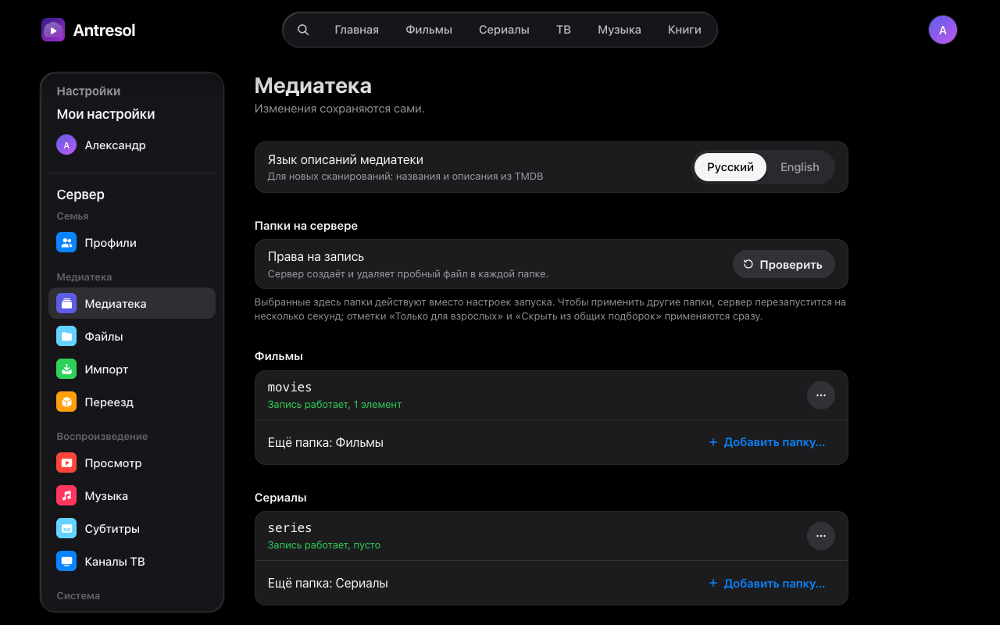
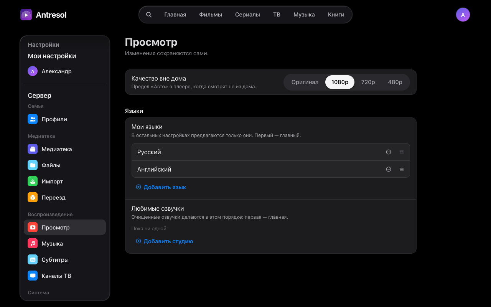

# Папки и файлы

## Как называть файлы

| Что | Пример |
| --- | --- |
| Фильм | `movies/Интерстеллар (2014)/Интерстеллар (2014).mkv` |
| Сериал | `series/Тьма/Season 01/Тьма S01E01.mkv` |
| Музыка | `music/Исполнитель/2019 - Альбом/01 - Трек.flac` |
| Книга | `books/ebooks/Автор - Название.epub` |
| Аудиокнига | `books/audiobooks/Автор - Название/*.mp3` или один `.m4b` |
| Манга и комиксы | `books/manga/Серия/Том 01.cbz` |

Год в скобках помогает найти правильный фильм. Обложку и фон можно положить рядом:
`poster.jpg` и `fanart.jpg`.

## Свои названия папок

**Настройки → Сервер → Медиатека → Папки на сервере.**

- Выберите, какая папка что хранит. У каждой библиотеки может быть несколько папок.
- Папки задаются относительно медиа-папки, которую `compose.yml` подключает как `/media`.



Те же папки можно задать в `.env` (`MOVIES_DIR`, `SERIES_DIR` и другие), но выбор в
интерфейсе главнее.

## Сканирование

Сервер сам проверяет папки каждые 15 минут. Чтобы не ждать:
**Медиатека → Сканирование → Пересканировать медиатеку** (кнопка «Начать»).

## Язык описаний

**Медиатека → Язык описаний медиатеки** — на каком языке брать названия и описания из
TMDB. Действует на новые сканирования.

## Языки и озвучки

**Настройки → Сервер → Просмотр.**

- **Мои языки** — языки, которые предлагают остальные настройки. Первый — главный.
- **Любимые озвучки** — в каком порядке делать очищенные озвучки: первая — главная. Строка
  есть, пока в «Моих языках» есть русский.
- **Качество вне дома** — потолок качества видео вне дома
  ([подробнее](public-address.html#что-меняется-вне-дома)).



## Временные файлы на другом диске

Сегменты воспроизведения и эфир каналов лежат в `tmp/antresol-hls` внутри медиа-папки.
Чтобы перенести их, например, на быстрый диск `/scratch`:

1. Создайте папку и дайте пользователю с uid 1000 право записи:
   `sudo mkdir -p /scratch/antresol-hls && sudo chown 1000:1000 /scratch/antresol-hls`.
2. Рядом с `compose.yml` создайте `compose.override.yml`:

   ```yaml
   services:
     antresol:
       environment:
         VAULT_TRANSCODE_DIR: /transcode
       volumes:
         - /scratch/antresol-hls:/transcode
   ```

3. Выполните `docker compose up -d`.

## Пути: хост и контейнер

Сервер работает в контейнере и видит медиа-папку как `/media`. В `.env` путь хоста бывает только
в `MEDIA_DIR`. Все переменные `VAULT_*_DIR` — пути внутри контейнера: `/tank/media/...` там
не существует.
