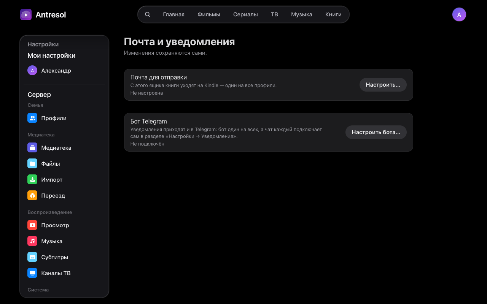
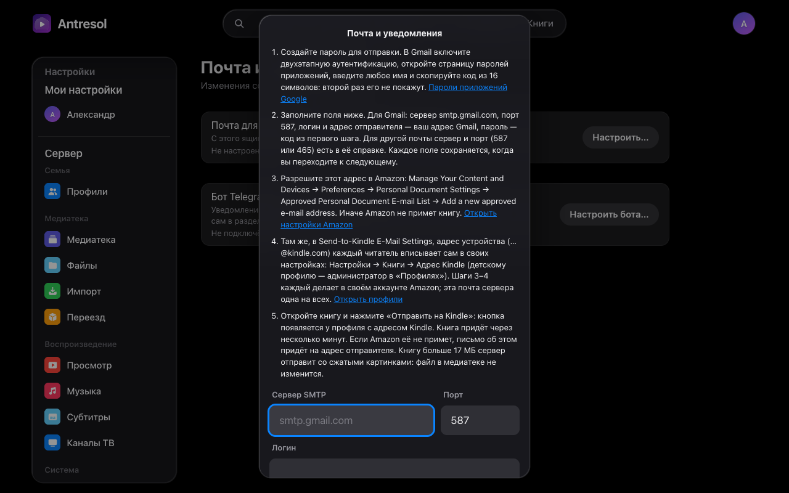
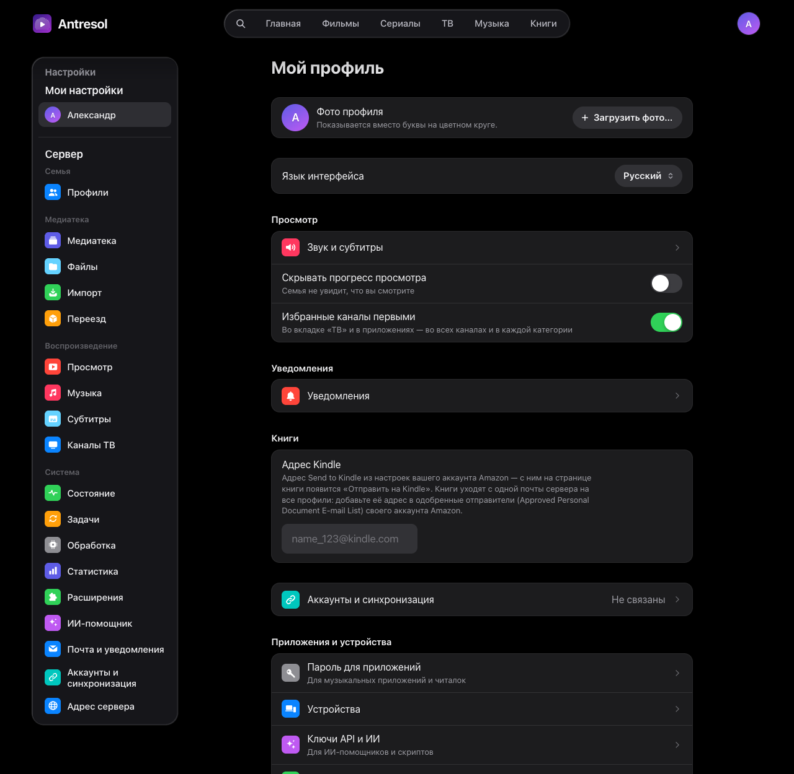

# Почта, Kindle и Telegram

Почта нужна для двух вещей: уведомлений и отправки книг на Kindle. Telegram — ещё один способ
получать уведомления. Ящик для отправки и бот Telegram администратор настраивает один раз в
**Настройки → Сервер → Почта и уведомления**.

## Почта для отправки

Нажмите **Почта для отправки → Настроить…** и заполните поля. Подойдёт любой ящик с SMTP:

| Сервис | Сервер | Порт | Логин | Пароль |
| --- | --- | --- | --- | --- |
| Gmail | `smtp.gmail.com` | 587 | адрес Gmail | [пароль приложения](https://myaccount.google.com/apppasswords) |
| Resend | `smtp.resend.com` | 587 | `resend` | ключ API |
| Другая почта | в её справке | 587 или 465 | обычно адрес | обычно пароль приложения |

Для Gmail сначала включите двухэтапную аутентификацию, иначе пароль приложения не создать.

## Книги на Kindle

Ящик для отправки один на весь сервер, а адрес Kindle у каждого свой.

**Один раз, администратор:** настройте почту для отправки (выше).

**Каждый читатель:**

1. На Amazon, в своём аккаунте, разрешите адрес отправителя — тот, что указан в «Почте для
   отправки»: **Manage Your Content and Devices → Preferences → Personal Document Settings →
   Approved Personal Document E-mail List**.
2. Там же скопируйте адрес Kindle (`…@kindle.com`) и вставьте его в **Настройки → Мои настройки →
   Книги → Адрес Kindle**. Сохраняется, когда вы выходите из поля.
3. Откройте книгу и нажмите **Отправить на Kindle**: кнопка есть у профиля с адресом Kindle.

Адрес детского профиля вписывает администратор: **Настройки → Сервер → Профили → Изменить**.

Книга придёт через несколько минут. Книги больше 17 МБ сервер отправляет со сжатыми картинками.

## Telegram

**Один раз, администратор:**

1. В Telegram откройте [@BotFather](https://t.me/BotFather), отправьте `/newbot` и придумайте имя.
2. Вставьте токен в **Бот Telegram → Настроить бота…** и нажмите **Проверить**.

**Каждый профиль:** **Настройки → Мои настройки → Уведомления → Подключить Telegram**, откройте
ссылку и нажмите «Запустить» в Telegram.

Публичный адрес и открытый порт для Telegram не нужны. Чтобы в сообщениях были ссылки на фильмы,
задайте [публичный адрес](public-address.html).

## Какие уведомления приходят

Каждый выбирает сам: **Настройки → Мои настройки → Уведомления**. Там же — подтверждение адреса
почты. Пока ничего не включено, писем нет. С 22:00 до 08:00 уведомления не приходят.
