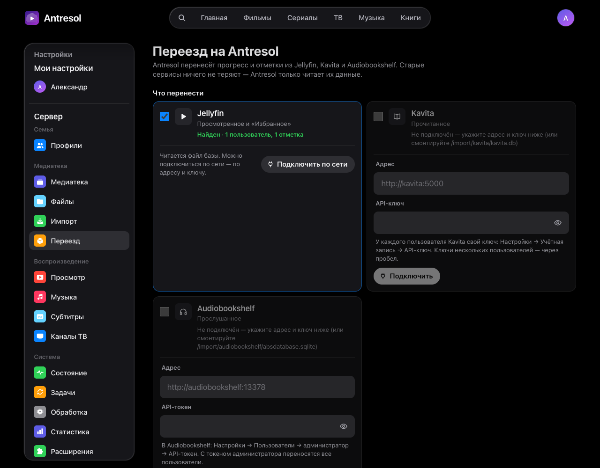

# Переезд с Jellyfin, Kavita и Audiobookshelf

Antresol переносит просмотренное и «Избранное» из Jellyfin, прочитанное из Kavita и
прослушанное из Audiobookshelf. Старые сервисы при этом ничего не теряют: Antresol только
читает их данные.



## 1. Подключите старые сервисы

Откройте **Настройки → Сервер → Переезд**. Дождитесь, пока медиатека Antresol отсканируется. У
каждого сервиса своя карточка. Проще всего подключиться по сети:

1. Впишите **Адрес** сервиса так, как его видит Antresol: адрес компьютера в вашей сети и порт,
   например `http://<адрес компьютера>:8096`. `localhost` не подойдёт: для контейнера это он сам.
2. Впишите ключ:

   | Сервис | Что нужно |
   | --- | --- |
   | Jellyfin | API-ключ: **Панель управления → API-ключи → «+»**. С ним переносятся все пользователи. Или имя и пароль: администратор Jellyfin переносит всех, остальные — только себя. |
   | Kavita | У каждого пользователя свой ключ: **Настройки → Учётная запись → API-ключ**. Ключи нескольких пользователей вписывают через пробел. |
   | Audiobookshelf | API-токен администратора: **Настройки → Пользователи → администратор → API-токен**. С ним переносятся все пользователи. |

3. Нажмите **Подключить**. Сервер проверит адрес и ключ и покажет, что нашёл: «Подключён · …».

Ключ и пароль сервер держит только в памяти, на диск они не пишутся, а перезапуск их забывает.
Кнопка **Забыть** убирает подключение раньше.

### Если по сети нельзя: файл базы

Antresol умеет читать и сами базы из папки `/import` внутри контейнера:

| Сервис | Файл, который нужен |
| --- | --- |
| Jellyfin | `/import/jellyfin/jellyfin.db` |
| Kavita | `/import/kavita/kavita.db` |
| Audiobookshelf | `/import/audiobookshelf/absdatabase.sqlite` |

Подключите папки с этими файлами в `compose.override.yml` рядом с `compose.yml`
(пути слева — ваши):

```yaml
services:
  antresol:
    volumes:
      - /opt/jellyfin/config/data:/import/jellyfin
      - /opt/kavita/config:/import/kavita
      - /opt/audiobookshelf/config:/import/audiobookshelf
```

Затем `docker compose up -d`. Карточка сервиса покажет «Найден · …». Файл читается, пока
сервис не подключён по сети; подключение по сети главнее.

## 2. Проверьте и перенесите

1. Отметьте сервисы, которые нужно перенести.
2. Для каждого старого пользователя выберите профиль Antresol.
3. Нажмите **Проверить**: появится отчёт, что перенесётся. Ничего ещё не меняется.
4. Нажмите **Перенести**.

Более новый прогресс в Antresol не затирается. Перенос можно запускать повторно: уже
перенесённое не повторится.

## 3. Уберите подключение

Когда всё перенесено, нажмите **Забыть** на подключённых карточках. Если подключали файлы баз,
удалите строки `/import/...` из `compose.override.yml` и выполните `docker compose up -d`.
