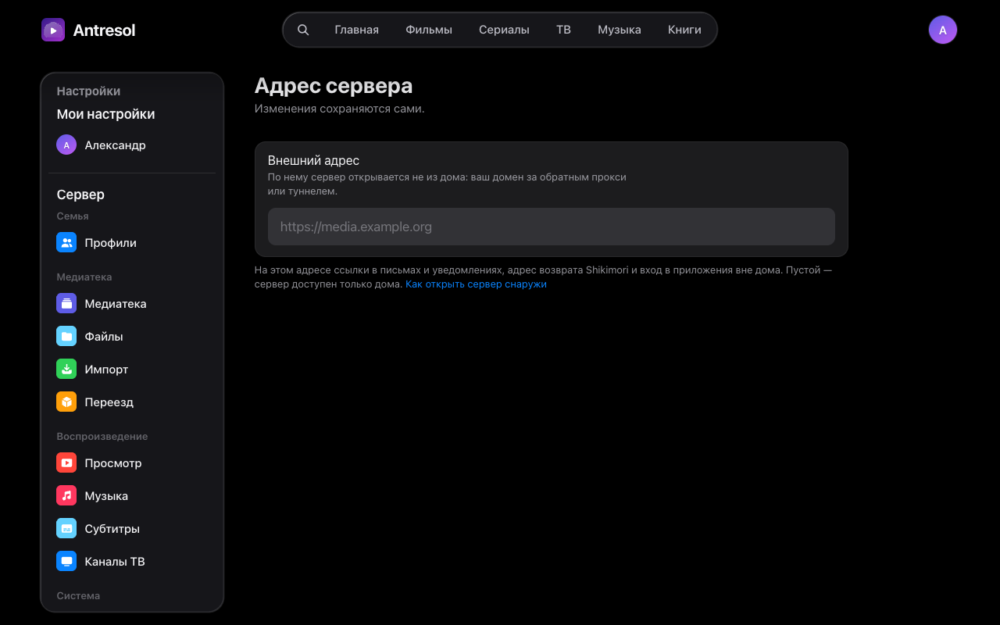

# Публичный адрес и доступ извне

Дома ничего настраивать не нужно: приложения находят сервер сами. Эта страница — о том, как
открыть сервер из интернета и сообщить ему его адрес.

## Что такое публичный адрес

Это адрес, по которому сервер открывается снаружи, например `https://media.example.com`.
Задаётся в интерфейсе: **Настройки → Сервер → Адрес сервера → Внешний адрес**. Без косой черты в
конце. Адрес сохраняется сразу, перезапускать сервер не нужно.



Тот же адрес можно задать в `.env` строкой `VAULT_PUBLIC_URL=https://media.example.com`. Она
главнее: в поле тогда виден этот адрес, а под ним написано «Задан на сервере (VAULT_PUBLIC_URL)».
Менять его можно только в `.env`.

Сервер использует этот адрес:

- в ссылках в письмах и сообщениях Telegram;
- для входа на Shikimori (адрес возврата, нужен HTTPS);
- в приложениях: подключившись дома, они запоминают и внешний адрес;
- в расширениях, которым нужен адрес сервера.

Сам по себе адрес сервер в интернет не открывает. Для этого нужен обратный прокси.

## Открыть сервер из интернета

Понадобится домен (или бесплатный поддомен DuckDNS и подобных), проброс портов 80 и 443 на
роутере и обратный прокси с HTTPS: Caddy, Nginx Proxy Manager, Traefik или nginx.

### 1. Настройте прокси

Прокси принимает HTTPS и передаёт запросы на `http://<компьютер с Antresol>:8420`.
Пример для Caddy (сертификат он получит сам):

```
media.example.com {
    reverse_proxy 127.0.0.1:8420
}
```

Пример для nginx:

```nginx
location / {
    proxy_pass http://127.0.0.1:8420;
    proxy_set_header Host $host;
    proxy_set_header X-Forwarded-For $proxy_add_x_forwarded_for;
    proxy_set_header X-Forwarded-Proto $scheme;
    proxy_buffering off;
    client_max_body_size 0;
}
```

Заголовки `X-Forwarded-For` и `X-Forwarded-Proto` обязательны: по ним сервер понимает, кто
пришёл и по HTTPS ли. Caddy, Nginx Proxy Manager и Traefik отправляют их сами.

### 2. Скажите серверу, что прокси свой

Без этого сервер не верит заголовкам прокси и считает каждый запрос внешним — даже из дома.

1. Откройте сервер через прокси.
2. Посмотрите журнал: `docker compose logs antresol | grep VAULT_TRUSTED_PROXIES`.
   Там будет строка `request from 172.18.0.1 carries X-Forwarded-For ... does not list it`.
3. Впишите этот адрес в `.env`:

   ```sh
   VAULT_TRUSTED_PROXIES=172.18.0.1
   ```

Можно перечислить несколько адресов или подсетей через запятую.

### 3. Задайте адрес

Впишите его в **Настройки → Сервер → Адрес сервера**. Если вы задаёте его в `.env`
(`VAULT_PUBLIC_URL=https://media.example.com`), затем выполните `docker compose up -d`.

Проверьте с телефона через мобильный интернет: `https://media.example.com` должен открыться.

## Что меняется вне дома

- Профили **без пароля** входят только из домашней сети. Поставьте пароль тем, кто будет
  смотреть вне дома.
- Качество видео вне дома ограничено, чтобы не упираться в канал:
  **Настройки → Сервер → Просмотр → Качество вне дома**. Для музыки — **Настройки → Сервер → Музыка → Музыка вне дома**.

## Без открытых портов: VPN

Если не хотите открывать сервер в интернет, используйте VPN — например, Tailscale или WireGuard.
Чтобы сервер считал VPN домашней сетью, добавьте её подсеть:

```sh
VAULT_TRUSTED_NETS=100.64.0.0/10
```

В этом случае внешним адресом можно задать адрес сервера в VPN.
