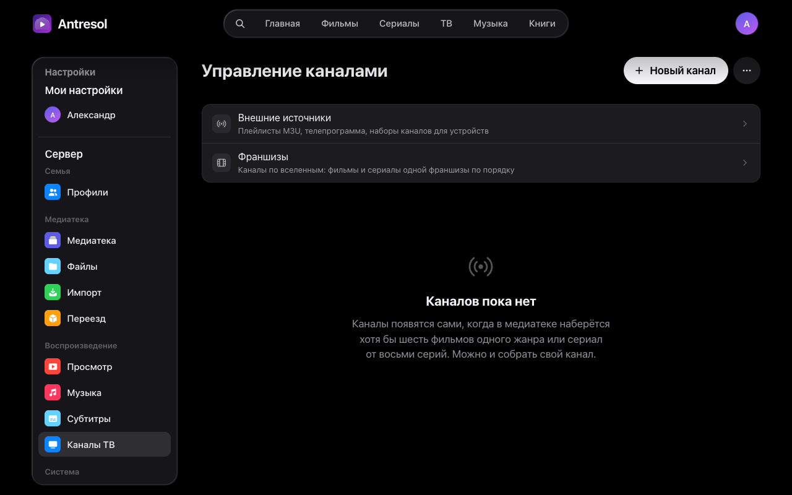
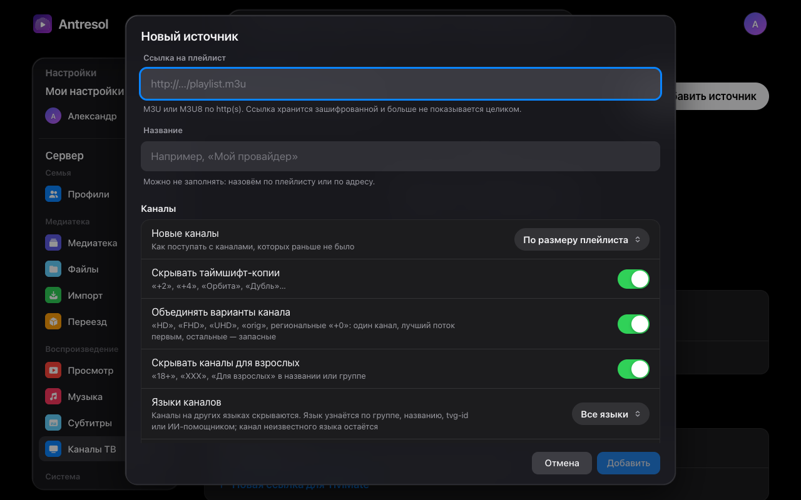

# ТВ-каналы и IPTV

Раздел **ТВ** показывает круглосуточные каналы из вашей медиатеки и каналы IPTV-провайдера
в одном списке, с телепрограммой.

## Каналы из медиатеки

Они появляются сами, когда в медиатеке набирается хотя бы шесть фильмов одного жанра или сериал
от восьми серий. Управляет ими администратор: **Настройки → Сервер → Каналы ТВ** (туда же ведёт
**ТВ → ⋯ → Управление каналами**). Остальные взрослые профили так же управляют своими личными
каналами, из «ТВ».

- **Новый канал** — собрать свой канал из выбранных фильмов и сериалов.
- **Франшизы** — каналы по вселенным: фильмы и сериалы одной франшизы по порядку. Разные
  коллекции TMDB и сериалы к фильмам объединяет Wikidata: если она выключена (**Настройки →
  Сервер → Внешние сервисы**), каждая коллекция остаётся отдельной франшизой.

## Каналы IPTV-провайдера

1. **Настройки → Сервер → Каналы ТВ → Внешние источники → Добавить источник.**
2. Вставьте ссылку на плейлист M3U или M3U8 провайдера. Название можно не заполнять.
3. Нажмите **Добавить**. Каналы появятся в «ТВ» рядом с каналами Antresol.

В карточке источника можно скрыть таймшифт-копии и каналы для взрослых, объединить варианты
одного канала (HD, FHD) и оставить только нужные языки.

## Как найти канал

В «ТВ» все каналы идут одним списком по номерам, а **Телегид** показывает программу сеткой. Звёздочка
справа от канала добавляет его в **Избранное**.

Когда категорий немного, над списком переключатель **Все / Избранное / категории**. Когда их много
(плейлист провайдера), «ТВ» открывается списком категорий с двумя первыми строками **Избранное** и
**Все каналы**. Категория открывает свои каналы, **Категории** возвращает назад.

Чтобы избранные были наверху — во всех каналах и в каждой категории, — включите **Настройки → Мои
настройки → Просмотр → Избранные каналы первыми**. Настройка своя у каждого профиля и действует в
приложениях тоже.

## Наборы и устройства

**Набор** — какие источники видит устройство. Например, «Подписка А» для гостиной и только
каналы Antresol для детской.

На странице **Внешние источники** внизу видны устройства, в которые входили профили. Выберите
для каждого набор.

## Каналы в IPTV-плеере (TiviMate и другие)

1. В `.env` добавьте `VAULT_IPTV=on` и выполните `docker compose up -d`.
2. **Внешние источники → Устройства → Новая ссылка для TiviMate.**
3. Выберите профиль и набор, назовите телевизор.
4. Скопируйте две ссылки в плеер: плейлист (M3U) и телепрограмму (XMLTV).

Ссылка действует с правами и ограничениями выбранного профиля.
