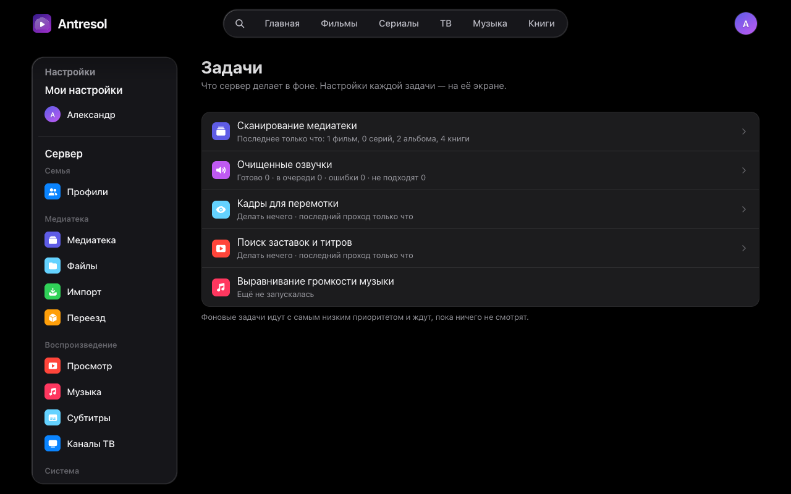

# Состояние и обновления

**Настройки → Сервер → Состояние** — один список о том, всё ли работает. Каждая проверка — строка:
кольцо (зелёная галочка, оранжевый или красный «!», серый прочерк для того, что вы не настраивали)
и короткое значение. Строку, где что-то нужно сделать, можно открыть: в листе сказано, что не так,
и дано одно действие или одна команда для копирования. Группы:

- **Доступ** — как сервер видит ваше соединение (из дома или нет и почему: прокси, о котором он не
  знает, незнакомое имя), внешний адрес, доходит ли до сервера HTTPS;
- **Диск и папки** — может ли сервер писать в медиа-папки (если нет, готовая команда), сколько
  места на медиадиске и на диске с настройками, чем кончилось последнее сканирование;
- **Видео** — есть ли ffmpeg, видеокарта, поиск заставок;
- **Каталог и интернет** — ключ TMDB, достаёт ли сервер до GitHub и сайтов с описаниями, часы и
  часовой пояс;
- **ТВ и почта** — обновляются ли источники ТВ, настроена ли почта;
- **Версии и обновления** — версия сервера и каждого расширения, что вышло новее;
- **Службы расширений** — отвечают ли их [вспомогательные службы](addon-services.html) (группа
  есть, когда у расширений такие службы заявлены).

То, что вы не настраивали (почта, внешний адрес, видеокарта), серое и ошибкой не считается. Ключ
TMDB и вход в почтовый ящик проверяются только кнопкой в их листе (письмо не отправляется).
**Проверить снова** опрашивает всё заново.


## Обновить сервер

В папке с `compose.yml`:

```sh
docker compose pull
docker compose up -d
```

Когда выходит новая версия, об этом говорит строка сервера, а в её листе лежит эта команда с
кнопкой **Скопировать**: сервер не может заменить свой контейнер сам. Настройки и база
лежат в томе `antresol-config` и сохраняются. Перед обновлением прочитайте, что нового в версии:
[Релизы](../releases.html) (на английском). Если версия требует действий, там это написано.

Администратор видит и плашку **«Вышла версия …»** в углу веб-приложения (проверка — не чаще раза в
шесть часов); **«Скрыть»** прячет этот релиз на этом устройстве, следующий покажется снова.
Приложения и скрипты читают тот же ответ по `GET /api/updates` (сессия администратора или
[API-ключ](api-and-mcp.html) с правом «Администрирование»): `version`, `latest`, `releaseUrl`,
`checked` (ответил ли GitHub), `newer` и `docker`.

## Обновить расширение

В **Версии и обновления** откройте строку расширения, у которого есть новая версия, и нажмите
**Обновить**. Сервер перезапускать не нужно.

## Что сервер делает в фоне

**Настройки → Сервер → Задачи** показывает ход фоновой работы: сканирование медиатеки, очищенные
озвучки, кадры для перемотки, поиск заставок и титров, громкость музыки. У каждой задачи видно,
сколько готово, идёт ли она сейчас и когда был последний проход. Страница обновляется сама.



Фоновые задачи идут с самым низким приоритетом и ждут, пока ничего не смотрят. Включить или
выключить их можно там, где они настраиваются: в **Медиатеке** и **Обработке**.

## Откатиться

Укажите в `compose.yml` нужную версию вместо `latest`, например
`ghcr.io/antresol-app/antresol-server:0.8.12`, и выполните `docker compose up -d`.
Новая версия может обновить базу, и старая с ней уже не заработает. Поэтому перед обновлением
полезно сохранить копию тома `antresol-config`.
