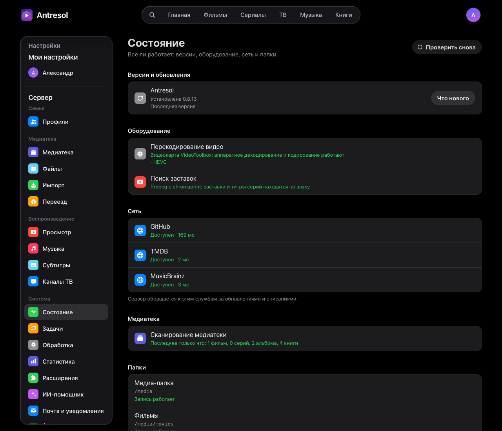

# Состояние и обновления

**Настройки → Сервер → Состояние** — одна страница о том, всё ли работает:

- **Версии и обновления** — версия сервера, установленные расширения и что вышло новее;
- **Службы расширений** — отвечают ли их [вспомогательные службы](addon-services.html) (строка
  есть, когда у расширений такие службы заявлены);
- **Оборудование** — нашлась ли видеокарта и ищутся ли заставки в сериях;
- **Сеть** — достаёт ли сервер до GitHub и сайтов с описаниями;
- **Медиатека** — чем кончилось последнее сканирование;
- **Папки** — может ли сервер писать в медиа-папки. Если нет, под строкой готовая команда.

**Проверить снова** опрашивает всё заново.



## Обновить сервер

В папке с `compose.yml`:

```sh
docker compose pull
docker compose up -d
```

Когда выходит новая версия, страница сама показывает эти команды в блоке «Как обновить сервер»
(рядом кнопка **Скопировать**): сервер не может заменить свой контейнер сам. Настройки и база
лежат в томе `antresol-config` и сохраняются. Перед обновлением прочитайте, что нового в версии:
[Релизы](../releases.html) (на английском). Если версия требует действий, там это написано.

## Обновить расширение

В **Версии и обновления** рядом с расширением, у которого есть новая версия, нажмите
**Обновить**. Сервер перезапускать не нужно.

## Что сервер делает в фоне

**Настройки → Сервер → Задачи** показывает ход фоновой работы: сканирование медиатеки, очищенные
озвучки, кадры для перемотки, поиск заставок и титров, громкость музыки. У каждой задачи видно,
сколько готово, идёт ли она сейчас и когда был последний проход. Страница обновляется сама.


Фоновые задачи идут с самым низким приоритетом и ждут, пока ничего не смотрят. Включить или
выключить их можно там, где они настраиваются: в **Медиатеке** и **Обработке**.

## Откатиться

Укажите в `compose.yml` нужную версию вместо `latest`, например
`ghcr.io/antresol-app/antresol-server:0.8.12`, и выполните `docker compose up -d`.
Новая версия может обновить базу, и старая с ней уже не заработает. Поэтому перед обновлением
полезно сохранить копию тома `antresol-config`.
