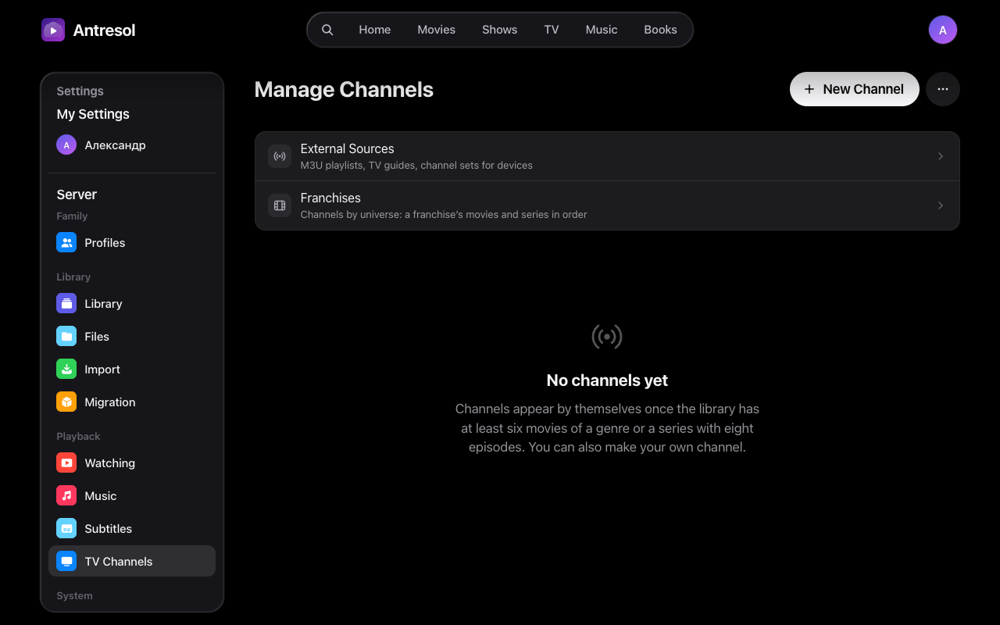
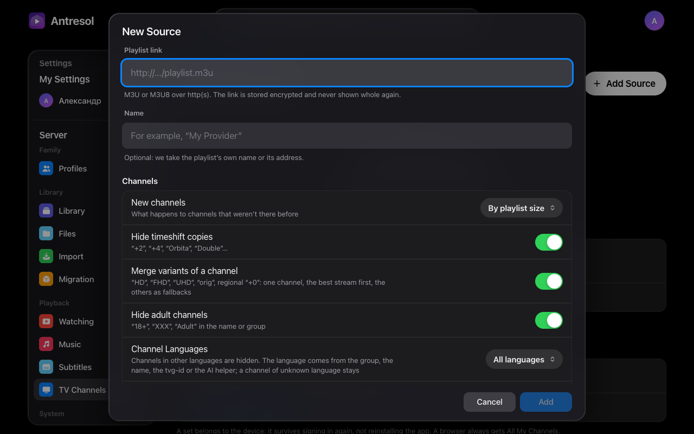

# TV channels and IPTV

The **TV** section shows round-the-clock channels made from your library and your IPTV
provider's channels in one list, with a programme guide.

## Channels from your library

They appear by themselves once the library has at least six films of one genre or a series of
eight episodes or more. The administrator manages them in **Settings → Server → TV Channels**
(**TV → ⋯ → Manage Channels** leads to the same screen). Other adult profiles manage their own
personal channels the same way, from TV.

- **New Channel**: build your own channel from chosen films and series.
- **Franchises**: channels per universe, the films and series of one franchise in order. Films
  and series of different TMDB collections are merged by Wikidata: with it off (**Settings →
  Server → External Services**), each collection stays a franchise of its own.

## Your IPTV provider's channels

1. **Settings → Server → TV Channels → External Sources → Add Source.**
2. Paste the provider's M3U or M3U8 playlist link. The name is optional.
3. Click **Add**. The channels appear in TV next to Antresol's.

The server downloads the playlist and the guide itself. It never connects to a link-local or
reserved address, and it reaches an address on your own network only when the playlist link is
written as an IP address, a name like `iptv.local` or `iptv.lan`, or a single word such as
`iptv`: a name from the internet that your home DNS points at a private address is refused
(`address not allowed` in the source's status), and so are the guide links a playlist names
itself unless the playlist is on your network. These downloads do not use the server's proxy
variables (`HTTP_PROXY`, `HTTPS_PROXY`): a server that reaches the internet only through a proxy
cannot fetch playlists.

A source's settings can hide timeshift copies and adult channels, merge variants of one channel
(HD, FHD) and keep only the languages you want.

**A channel with no sound.** Some providers send audio that browsers cannot decode (MP2, AC-3,
E-AC-3, DTS). The first time you tune in, the server looks at the start of the stream. If its
audio is one of those, the browser plays the channel through the server, which copies the video
as it is and converts only the audio to AAC stereo: one `ffmpeg` per such channel being watched
(at most 6 at once), little CPU. A channel with AAC or MP3 audio is never touched. What the
server found is remembered for 12 hours. The apps still play the provider's address directly.

## Finding a channel

In TV all channels are one list in number order, and **Guide** shows the programme as a grid. The
star at the right of a channel adds it to **Favorites**.

With few categories, a switch **All / Favorites / categories** sits above the list. With many (a
provider's playlist), TV opens on a list of categories whose first two rows are **Favorites** and
**All channels**. A category opens its channels, **Categories** goes back.

To keep favourites at the top, in all channels and in every category, turn on **Settings → My
Settings → Watching → Favorite channels first**. Each profile has its own switch, and it works in
the apps too.

## Sets and devices

A **set** is which sources a device sees: for example, "Subscription A" for the living room and
only Antresol's channels for the kids' room.

At the bottom of **External Sources** are the devices profiles have signed in on. Pick a set for
each.

## Channels in an IPTV player (TiviMate and others)

1. Add `VAULT_IPTV=on` to `.env` and run `docker compose up -d`.
2. **External Sources → Devices → New Link for TiviMate.**
3. Pick a profile and a set, and name the TV.
4. Copy both links into the player: the playlist (M3U) and the guide (XMLTV).

The link has the chosen profile's access and limits.
