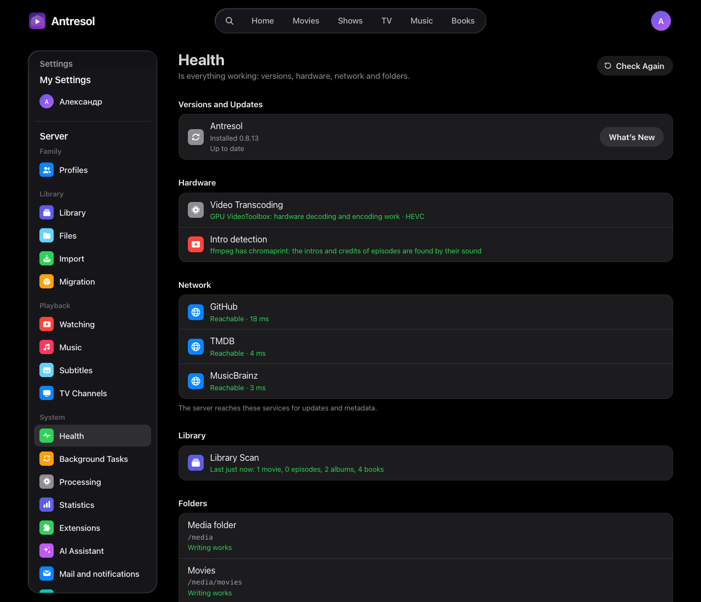

# Health and updates

**Settings → Server → Health** is one list about whether everything works. Each check is a row:
a ring (a green check, an orange or red "!", a grey dash for something you did not set up) and a
short value. A row that needs something opens with a tap: the sheet says what is wrong and gives
one action or one command to copy. The groups:

- **Access**: how the server sees your connection (at home or not, and why: a proxy it was not
  told about, a name it does not know), the public address, and whether HTTPS reaches the server;
- **Disk and Folders**: whether the server can write to the media folders (if not, a ready
  command), how much room is left on the media disk and on the settings disk, how the last scan
  ended;
- **Video**: whether ffmpeg is there, the graphics card, intro detection;
- **Catalog and Internet**: the TMDB key, whether the server reaches GitHub and the sites with
  descriptions, the clock and time zone;
- **TV and Mail**: whether the TV sources refresh, whether mail is set up;
- **Versions and Updates**: the server's version and each extension's, and what is newer;
- **Addon Services**: whether the extensions' [helper services](addon-services.html) answer (the
  group is there when extensions declare such services).

What you did not set up (mail, a public address, a graphics card) is grey and never counts as a
fault. The TMDB key and the mailbox's sign-in are tested only by the button in their sheet (no
letter is sent). **Check Again** asks everything again.



## Update the server

In the folder with `compose.yml`:

```sh
docker compose pull
docker compose up -d
```

When a new version comes out, the row of the server says so, and its sheet has this command with a
**Copy** button: the server cannot replace its own container. Settings and the
database live in the `antresol-config` volume and are kept. Before updating, read what is new:
[Releases](releases.html). If a version needs anything from you, it says so there.

An administrator also sees a **Version … Is Out** banner in the corner of the web app (checked at
most every six hours); **Hide** hides that release on this device, and the next one shows again.
Apps and scripts can read the same answer at `GET /api/updates` (an administrator's session or an
[API key](api-and-mcp.html) with Administration): `version`, `latest`, `releaseUrl`, `checked`
(whether GitHub answered), `newer` and `docker`.

## Update an extension

Under **Versions and Updates**, tap the row of an extension with a newer version and press
**Update**. No server restart.

## What the server does in the background

**Settings → Server → Background Tasks** shows the progress of the background work: the library
scan, cleaned voice-overs, scrubbing previews, intro and credits detection, music loudness. For
each task you see how much is done, whether it runs now and when it last ran. The page refreshes
by itself.


Background tasks run at the lowest priority and wait while something is playing. They are set up
where they belong: in **Library** and **Processing**.

## Go back

Put the version you want in `compose.yml` instead of `latest`, for example
`ghcr.io/antresol-app/antresol-server:0.8.12`, and run `docker compose up -d`.
A newer version may upgrade the database so that an older one no longer runs with it, so it is
worth keeping a copy of the `antresol-config` volume before updating.
