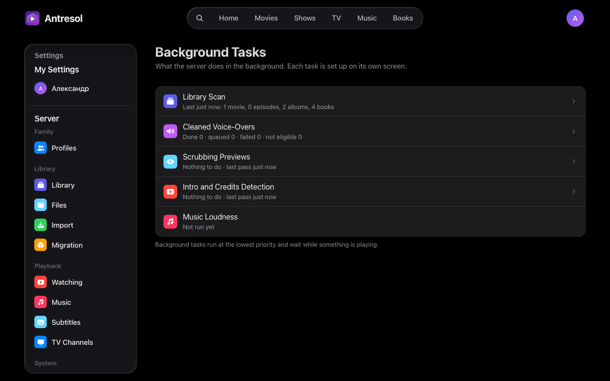

# Health and updates

**Settings → Server → Health** is one page about whether everything works:

- **Versions and Updates**: the server's version, the installed extensions, and what is newer;
- **Addon Services**: whether the extensions' [helper services](addon-services.html) answer (the
  section is there when extensions declare such services);
- **Hardware**: whether a graphics card was found and whether intros are detected in series;
- **Network**: whether the server reaches GitHub and the sites with descriptions;
- **Library**: how the last scan ended;
- **Folders**: whether the server can write to the media folders. If not, a ready command sits
  under the line.

**Check Again** asks everything again.


## Update the server

In the folder with `compose.yml`:

```sh
docker compose pull
docker compose up -d
```

When a new version comes out, the page shows these commands by itself in "How to Update the
Server" (with a **Copy** button): the server cannot replace its own container. Settings and the
database live in the `antresol-config` volume and are kept. Before updating, read what is new:
[Releases](releases.html). If a version needs anything from you, it says so there.

## Update an extension

Under **Versions and Updates**, click **Update** next to an extension with a newer version. No
server restart.

## What the server does in the background

**Settings → Server → Background Tasks** shows the progress of the background work: the library
scan, cleaned voice-overs, scrubbing previews, intro and credits detection, music loudness. For
each task you see how much is done, whether it runs now and when it last ran. The page refreshes
by itself.



Background tasks run at the lowest priority and wait while something is playing. They are set up
where they belong: in **Library** and **Processing**.

## Go back

Put the version you want in `compose.yml` instead of `latest`, for example
`ghcr.io/antresol-app/antresol-server:0.8.12`, and run `docker compose up -d`.
A newer version may upgrade the database so that an older one no longer runs with it, so it is
worth keeping a copy of the `antresol-config` volume before updating.
